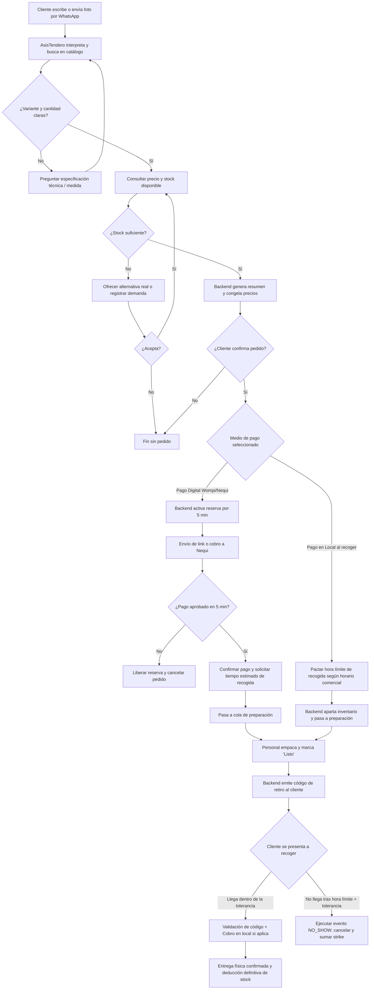
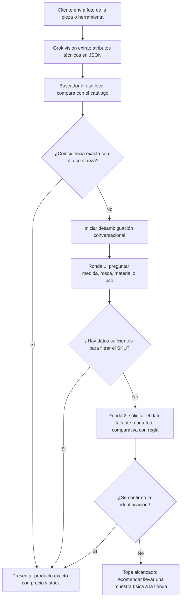
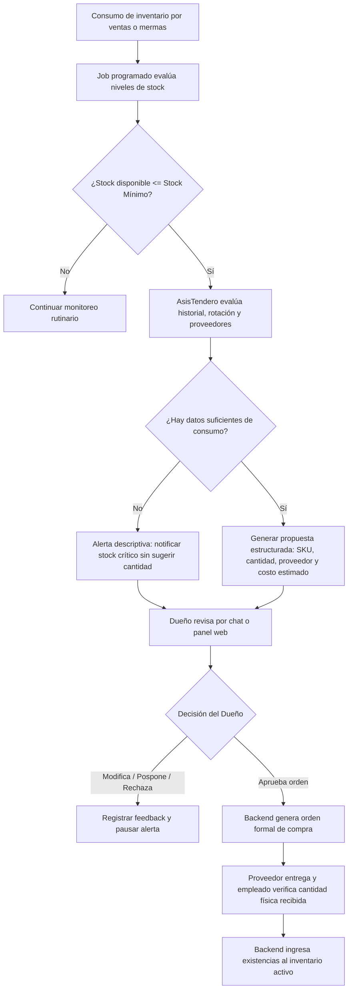

# PT-001 — Comercio piloto, usuarios, alcance y recorridos

**Estado:** Borrador revisado para alineación del equipo.\
**Versión:** 0.3, 13 de octubre de 2026.\
**Base:** Consenso técnico sobre el borrador v0.2, decisiones de alcance acordadas y notas de taller.

## 1. Identidad, objetivo y adaptabilidad

AsisTendero es el nombre del agente conversacional inteligente impulsado por Grok. PulsoTienda continúa como el nombre de trabajo de la plataforma operativa backend y el tablero de administración.

### Objetivo de PT-001

Formalizar el alcance funcional del primer corte operativo (Semana 1 / MVP), definir los actores involucrados, consolidar los tres recorridos principales y estipular los requisitos de datos mínimos necesarios para el desarrollo.

### Selección de piloto y principio de adaptabilidad multinegocio

**Comercio piloto seleccionado:** Ferretería. Se prioriza este rubro debido a su alta exigencia técnica en variantes, medidas, compatibilidades y atributos estructurados.

**Arquitectura adaptable (Multinegocio):** La solución mantiene un núcleo transaccional común (pedidos, catálogo, inventario, pasarela y clientes) desacoplado de las particularidades de cada industria. Mientras la ferretería explota atributos como rosca, material, longitud, calibre o voltaje, el mismo esquema admite sin rediseño los campos de minimercados/tiendas de barrio (gramaje, volumen, lote, vencimiento) y papelerías.

## 2. Alcance del agente y decisiones humanas

AsisTendero interactúa a través de WhatsApp: interpreta consultas en lenguaje natural, procesa fotos de artículos, consulta catálogo e inventario en tiempo real, resuelve dudas técnicas guiadas, congela precios, gestiona reservas y coordina pagos o retiros.

### Límites de autonomía (Decisiones humanas no delegables)

- El agente nunca aprueba compras a proveedores. Solo detecta faltantes, analiza históricos y presenta sugerencias justificadas.
- El agente nunca autoriza créditos ni fiados.
- El agente nunca altera precios de venta ni otorga descuentos extraordinarios de forma autónoma.
- Los pagos presenciales y las entregas físicas requieren validación y confirmación en caja o mostrador por personal autorizado.

## 3. Superficies y actores

| Actor                      | Responsabilidad operativa                                                                                                                                       |
| -------------------------- | --------------------------------------------------------------------------------------------------------------------------------------------------------------- |
| Cliente                    | Escribe por WhatsApp, envía fotos de piezas, responde preguntas aclaratorias, selecciona medio de pago, estima hora de llegada y presenta su código al retirar. |
| AsisTendero (Grok + Tools) | Conduce la conversación, estructura especificaciones, valida disponibilidad, crea órdenes y calcula tiempos de tolerancia.                                      |
| Dueño                      | Establece políticas comerciales, configura umbrales de strikes/tolerancia y aprueba órdenes de compra a proveedores.                                            |
| Empleado / Encargado       | Prepara físicamente el pedido, valida códigos de entrega, recibe pagos en efectivo/datáfono y reporta entregas completadas.                                     |
| Plataforma / Backend       | Fuente de verdad: administra persistencia, bloqueos de concurrencia, snapshots de precios, temporizadores y webhooks.                                           |
| Pasarela (Wompi)           | Procesa pagos digitales (Nequi / enlace de pago) y emite eventos firmados y verificables.                                                                       |
| Proveedor                  | Suministra mercancía; sus tiempos y costos alimentan las recomendaciones del sistema.                                                                           |

## 4. Capacidades y grado de madurez

| Capacidad                 | Alcance Semana 1 (Corte inicial)                                                                  | Maduración posterior                                                                      |
| ------------------------- | ------------------------------------------------------------------------------------------------- | ----------------------------------------------------------------------------------------- |
| WhatsApp + Grok           | Interacción conversacional completa para consultas técnicas, armado de pedido y seguimiento.      | Plantillas proactivas, difusión masiva y soporte multicanal.                              |
| Catálogo y Precios        | Búsqueda por coincidencia local difusa y snapshot inmutable de precio al confirmar pedido.        | Historial de fluctuación de costos, listas de precios mayoristas.                         |
| Identificación por Imagen | Extracción estructurada vía Grok visión con hasta 2 rondas de aclaración técnica.                 | Reconocimiento visual de códigos de barras/marcas de troquel.                             |
| Reserva y Tiempos         | Separación entre ventana de pago digital (5 min) y horario de recogida acordado.                  | Agendamiento por franjas horarias estrictas y recordatorios por geolocalización.          |
| Inasistencias (Strikes)   | Registro automático de NO_SHOW, acumulación por cliente y bloqueo de pago en local tras 2 faltas. | Análisis predictivo de riesgo de cancelación y listas negras compartidas entre comercios. |
| Reposición                | Alertas de stock bajo con cálculo básico y autorización obligatoria por el dueño.                 | Proyección estacional, plazos de entrega promedio y optimización de fletes.               |

## 5. Recorrido R1 — Consulta, compra, reserva y recogida

### Reglas operativas de R1

**Inmutabilidad de precios (Price Snapshot):** Al confirmar el pedido, el precio unitario y total se congelan en la orden. Modificaciones posteriores en el catálogo no alteran los pedidos ya creados.

**Diferenciación de reservas y tiempos:**

- **Pago digital:** Reserva de inventario activa por 5 minutos (ampliable una sola vez por 5 minutos si el cliente reconfirma). Una vez aprobado el pago, el stock queda garantizado y el cliente informa su hora estimada de retiro.
- **Pago en local:** Se asigna una `pickup_deadline` (hora pactada de llegada dentro del horario del negocio). No se aplica la regla de expiración de 5 minutos.

**Manejo de inasistencias (Strikes):**

Si un pedido con pago en tienda supera la hora pactada más el margen de tolerancia configurable (por defecto 30 minutos), el backend cancela la orden, devuelve el producto al stock disponible y registra un evento `NO_SHOW` en el perfil del cliente.

- **Primer strike:** Advertencia automática por chat sobre el pedido no retirado.
- **Segundo strike:** Restricción de canal: AsisTendero informa que en adelante solo podrá ordenar mediante pago previo digital (Wompi/Nequi).
- **Tercer strike / Tope:** Suspensión preventiva del cliente para emitir órdenes automáticas por WhatsApp, requiriendo desbloqueo manual del dueño.

## 6. Recorrido R2 — Identificación asistida por imagen y desambiguación

En ferretería, la variabilidad milimétrica de roscas, diámetros y voltajes hace peligroso adivinar basándose únicamente en píxeles.

### Reglas operativas de R2

**Extracción estructurada económica:** Se envía la foto a Grok visión una sola vez para generar un JSON con tipo de artículo, material, escala estimada y marcas visibles.

**Acompañamiento guiado:** El agente asiste al cliente para aclarar qué necesita (ej. "¿El tornillo es para madera o lámina?", "¿Qué diámetro tiene la broca?").

**Regla de tope seguro (Anti-alucinación):** Si tras un máximo de 2 interacciones no hay certeza técnica, AsisTendero no arriesga una venta errónea. Debe emitir el mensaje de salvaguarda:

> Para garantizar compatibilidad exacta y evitar que lleves la pieza incorrecta, te sugerimos traer la muestra física a nuestra ferretería para atenderte en el mostrador.

## 7. Recorrido R3 — Control de inventario y reposición con aprobación humana

El agente actúa como monitor proactivo, reduciendo quiebres de stock sin usurpar la autoridad financiera del comerciante.

### Reglas operativas de R3

**Transparencia ante datos escasos:** Si el negocio no cuenta con métricas previas de rotación, el agente advierte la falta de histórico y solicita al dueño definir la cantidad a solicitar, evitando cálculos inventados.

**Autoridad indelegable:** Ninguna orden de compra sale hacia el proveedor sin la aprobación explícita (vía WhatsApp o panel) del rol Dueño.

**Actualización de inventario:** El inventario se incrementa por recepción física verificada, nunca por el simple hecho de emitir o aprobar la orden.

## 8. Especificación de datos mínimos

Para implementar estos flujos de forma coherente en backend y base de datos, se fijan las siguientes entidades y atributos obligatorios.

### 8.1. Negocio y configuración (`businesses`, `business_settings`)

- `id`: UUID único por negocio.
- `trade_name`: Nombre comercial (ej. "Ferretería El Tornillo").
- `business_type`: `HARDWARE_STORE` | `GROCERY_STORE` | `STATIONERY`.
- `no_show_grace_minutes`: Tiempo de tolerancia tras hora pactada (defecto: 30 min).
- `max_strikes_before_prepay`: Número de strikes para restringir a pago anticipado (defecto: 2).
- `max_strikes_before_ban`: Límite de inasistencias antes de suspensión (defecto: 3).

### 8.2. Catálogo y atributos técnicos (`products`, `product_variants`)

- `id`, `business_id`, `sku`, `title`, `description`, `base_price`, `is_active`.
- `attributes` (JSONB dinámico para adaptabilidad multinegocio):
  - Ferretería: `{"material": "acero_galvanizado", "thread": "fina", "diameter": "1/4", "length": "2 pulgadas"}`.
  - Tienda: `{"net_weight": "500g", "expiration_required": true, "presentation": "bolsa"}`.
- `min_stock_alert`: Umbral de inventario mínimo para disparar reposición.

### 8.3. Pedidos e inmutabilidad (`orders`, `order_items`)

**`orders`:**

- `id`, `business_id`, `customer_id`.
- `payment_mode`: `DIGITAL_PREPAID` | `PAY_ON_PICKUP`.
- `payment_status`: `PENDING` | `APPROVED` | `REJECTED` | `PAID_IN_STORE`.
- `order_status`: `DRAFT` | `RESERVED` | `PREPARING` | `READY_FOR_PICKUP` | `COMPLETED` | `CANCELLED` | `EXPIRED` | `NO_SHOW`.
- `pickup_estimated_at`: Timestamp acordado de llegada (en pedidos prepagados).
- `pickup_deadline`: Timestamp tope de retiro (en pedidos con pago en tienda).
- `total_frozen_amount`: Total monetario exacto congelado durante la confirmación.
- `delivery_code`: Código alfanumérico de un solo uso para validación presencial.

**`order_items`:**

- `id`, `order_id`, `product_id`, `quantity`, `unit_price_frozen`.

### 8.4. Perfil del cliente y control de inasistencias (`customers`)

- `id`, `business_id`, `whatsapp_phone_number`.
- `strikes_count`: Conteo acumulado de pedidos no reclamados.
- `force_prepay`: Booleano (se activa al alcanzar el segundo strike).
- `is_suspended`: Booleano para bloqueo de pedidos automáticos.

## 9. Decisiones firmes vs. tareas pendientes para cierre definitivo

| Decisión / Aspecto          | Estado actual     | Acción inmediata                                                                                                                         |
| --------------------------- | ----------------- | ---------------------------------------------------------------------------------------------------------------------------------------- |
| Rubro del piloto            | **[ACORDADO]**    | Ferretería seleccionada como modelo principal de prueba.                                                                                 |
| Adaptabilidad técnica       | **[ACORDADO]**    | Atributos flexibles por JSONB para admitir otros rubros sin migrar tablas.                                                               |
| Separación de reservas      | **[ACORDADO]**    | 5 min para pasarela digital; hora pactada para pago en tienda física.                                                                    |
| Inmutabilidad de precios    | **[ACORDADO]**    | Price snapshot al confirmar orden.                                                                                                       |
| Política de inasistencias   | **[ACORDADO]**    | Regla de 3 strikes implementada en el primer corte operativo.                                                                            |
| Identificación por foto     | **[ACORDADO]**    | Máximo 2 intentos de desambiguación antes de derivar al local.                                                                           |
| Establecimiento físico real | **[POR VALIDAR]** | Pendiente crítico: Definir la ferretería concreta, firmar autorización de datos y levantar la muestra inicial del catálogo en CSV/Excel. |
| Número WhatsApp Business    | **[POR VALIDAR]** | Registrar número de prueba y verificar alta en Cloud API de WhatsApp.                                                                    |