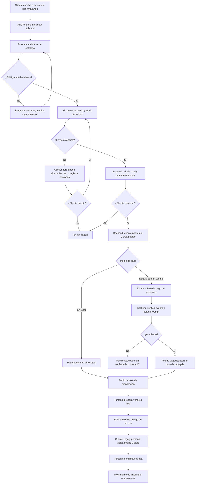
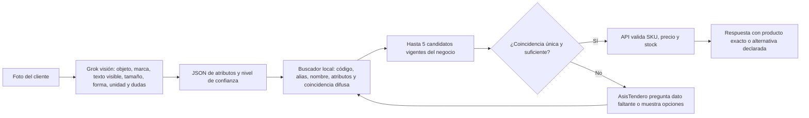
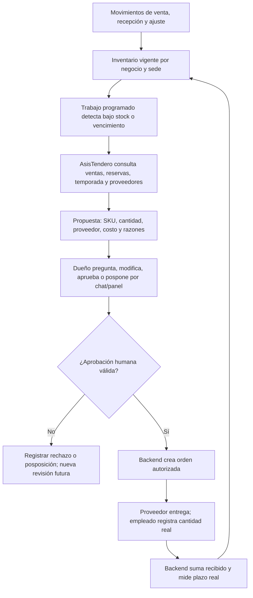

# PT-001 — Comercio piloto, usuarios, alcance y recorridos

**Estado:** borrador para revisión conjunta, no issue completada. **Versión:** 0.2, 12 de octubre de 2026. **Base:** recopilación entregada por el usuario `AsisTendero_Recopilacion_PT-001_PT-002 (1).md` y precisiones posteriores en la conversación. La recopilación es una propuesta de producto, no una instrucción para ejecutar cambios ni evidencia de implementación.

## 1. Identidad y objetivo

**AsisTendero** es el nombre del **agente**. **PulsoTienda** continúa como nombre de trabajo de la plataforma y del tablero; el nombre comercial de la plataforma sigue abierto. El producto combina un agente Grok que opera por conversación con un sistema de catálogo, inventario, pedidos, pagos, proveedores y seguimiento.

**Objetivo de PT-001:** definir a quién sirve la primera operación, qué resultado completo debe producir el agente, qué personas intervienen, qué datos hacen falta y cuáles son los tres recorridos principales. Esta issue es documental; no prueba que el agente o sus integraciones funcionen.

**Segmentos principales acordados:** tienda de barrio/minimercado **y ferretería**. La solución debe servir a ambos sin rehacer su estructura: los productos de ferretería requieren medidas, variantes, marcas, compatibilidades y unidades; los de tienda pueden requerir presentaciones, lotes y vencimientos. **Papelería** es una posible proyección sujeta a avance y costo. El primer establecimiento real todavía no está seleccionado; se puede comenzar con un solo piloto operativo sin reducir los dos segmentos de destino a una mera «expansión».

## 2. Qué debe hacer el agente

El cliente conversa por **WhatsApp**: pregunta, envía foto, compara opciones, arma pedido, elige pago y coordina recogida. AsisTendero interpreta la solicitud, usa herramientas de negocio, consulta precio y stock actuales, propone alternativas reales, crea y sigue la reserva, prepara el medio de pago y avisa al personal. El dueño consulta por su chat y recibe alertas, propuestas y explicaciones. Las decisiones comerciales importantes permanecen en manos humanas: precios, descuentos extraordinarios, compras a proveedor, fiados, ajustes relevantes, devoluciones excepcionales y cambios de política.

La **primera semana** es un corte demostrable de extremo a extremo, no la definición de todo el producto ni una excusa para excluir capacidades acordadas. Foto, código de entrega, reserva de cinco minutos, pago digital sencillo, proveedores, fiados y seguimiento quedan en el mapa integral. Su profundidad, automatización y cobertura aumentan por etapas. El requisito oficial de S1 es un flujo conectado a Grok, repositorio público y README; los hitos siguientes piden herramientas, evaluaciones y carga. Ver [reto oficial](https://reto.pltk.mx/). No afirmar cumplimiento hasta ejecutarlo.

## 3. Superficies y actores

| Actor | Responsabilidad |
|---|---|
| Cliente | Consulta por WhatsApp, confirma artículos, cantidades, medio de pago y recogida; presenta código al retirar. |
| AsisTendero (Grok + herramientas) | Lleva la conversación y coordina tareas rutinarias dentro de políticas; explica datos y prepara decisiones humanas. |
| Dueño | Define políticas, precios y permisos; aprueba compras, fiados y excepciones de dinero o crédito. |
| Encargado | Supervisa cola, preparación, inventario y atención, con límites definidos por el dueño. |
| Empleado | Cuenta, prepara y entrega físicamente; registra hechos observados con permisos concretos. |
| Plataforma/backend | Verifica identidad, reglas, transacciones, tiempos y eventos; es la fuente de verdad. |
| Wompi u otra pasarela apta | Procesa el pago digital. La opción principal a evaluar es Wompi con Nequi. |
| Proveedor | Entrega mercancía después de una orden autorizada; su historial alimenta propuestas. |

El cliente no administra la plataforma. El administrador de plataforma gestiona altas y operación del servicio sin acceso ordinario a datos privados de cada negocio.

## 4. Capacidades y grado de madurez

| Capacidad acordada | Corte de primera semana | Maduración posterior |
|---|---|---|
| WhatsApp + Grok | Conversación real de un comercio con consultas y pedido, sujeto a PT-008 sobre términos/alta. | Plantillas, continuidad, escalamiento, múltiples negocios y observabilidad. |
| Catálogo e inventario | Muestra real autorizada, carga manual/CSV, precio y disponibilidad consultables, reserva sin sobreventa. | Importación robusta, lotes, vencimientos, auditoría y varias sedes. |
| Foto de producto | Una foto se traduce en atributos estructurados y candidatos del catálogo; aclaración si hay ambigüedad. | Evaluación por rubro, optimización de imagen, códigos/OCR y umbrales medidos. |
| Pedido y recogida | Pedido con varios artículos, total validado, reserva de 5 minutos, una extensión confirmada de 5 minutos como regla inicial, código de entrega. | Agenda, reprogramación de pagados, expiración y excepciones plenamente parametrizadas. |
| Pago | Pago en local o recorrido digital prioritario Wompi/Nequi cuando las cuentas y condiciones estén habilitadas; el estado nunca se confirma por una captura. | Reconciliación completa, pagos tardíos, devoluciones y soporte por negocio. |
| Reposición | Alerta simple y propuesta explicada de cantidad/proveedor, con aprobación humana. | Estacionalidad, plazos reales, demanda nueva, costo y evaluación de rentabilidad. |
| Fiado | Regla visible: el agente no otorga crédito; puede derivar solicitud/reserva al local. | Registro presencial autorizado, abonos, saldos y recordatorios con política. |
| Chat del dueño | Consulta de pedidos/stock y explicación de una alerta o propuesta. | Aprobaciones conversacionales, informes y seguimiento de excepciones. |

La tabla marca **objetivos de implementación**, no funciones existentes. Si una integración externa impide un corte, documentar el bloqueo y conservar un recorrido verificable que sí use Grok y datos reales; no simular una integración y presentarla como producción.

## 5. Recorrido R1 — Consulta, compra y recogida

**Condiciones:** cinco minutos son la reserva inicial para compra inmediata. Antes de vencer, AsisTendero puede pedir reconfirmación para cinco minutos adicionales. La cantidad máxima de extensiones y la política de retiro programado deben validarse con el negocio. Un pedido ya pagado no se libera automáticamente como uno sin pagar; si el cliente llega tarde, el agente gestiona reprogramación dentro de la política. Si un pago se aprueba después de caducar la reserva, el backend revalida stock y AsisTendero propone cumplimiento, alternativa aceptada o devolución supervisada. El código no sustituye la entrega física ni la comprobación de estado.

**Pago digital:** Wompi documenta [links de importe exacto, uso único y expiración](https://docs.wompi.co/docs/colombia/links-de-pago/) y [Nequi como medio de pago](https://docs.wompi.co/docs/colombia/metodos-de-pago/). La experiencia propuesta es enviar un enlace corto por WhatsApp o, si conviene y está habilitado, solicitar solo el teléfono Nequi para aprobación en la app. La modalidad se elegirá tras probar el recorrido del cliente y verificar cuentas por comercio. El backend debe verificar [eventos firmados](https://docs.wompi.co/docs/colombia/eventos/) o consultar la transacción; una captura no equivale a pago recibido.

## 6. Recorrido R2 — Identificación económica por imagen

No se enviará el catálogo completo ni se comparará cada foto con cientos de imágenes dentro del prompt. El objetivo es **extraer una descripción estructurada una vez**, buscar en el inventario de forma determinista y usar Grok solo para aclarar o elegir entre pocos candidatos.

**Ferretería:** preguntar medida, rosca, voltaje, material o compatibilidad cuando la foto no los demuestre. **Tienda:** preguntar presentación, peso, sabor o marca cuando sea relevante. El agente no afirma equivalencias técnicas por apariencia. Una foto mala puede terminar en «no identificado» y traspaso humano. La reducción de tokens es una **hipótesis de diseño** que se comprobará con el consumo real de la API.

## 7. Recorrido R3 — Inventario y reposición guiados por el agente

Este recorrido transforma el antiguo R3, centrado en edición manual, en un caso que muestra trabajo de AsisTendero. La carga y corrección física siguen siendo humanas; el agente detecta, analiza, recomienda y da seguimiento.

La primera semana puede limitarse a una alerta y propuesta sobre datos reales. El ciclo completo con orden, recepción y evaluación de proveedor debe quedar integrado en las siguientes tareas; **no se elimina de la visión**. Una aprobación no aumenta stock: la recepción comprobada sí. El dueño conserva las decisiones de compra. El agente también puede registrar solicitudes repetidas de productos que no existen y proponer una prueba comercial con evidencia, sin asumir que cada consulta será una venta.

## 8. Datos mínimos y pendientes que impiden cerrar PT-001

**Datos:** negocio y sede; productos/SKU, nombres/alias, variantes, fotos, unidad y precio; stock físico/reservado; cliente y conversación; pedido y líneas; pago e intento; código/entrega; movimiento; proveedor y oferta; usuario/rol/aprobación. Guardar `business_id` y origen/fecha de cada dato. La fuente inicial es carga manual o importación CSV/Excel autorizada, con responsable de mantenerla actualizada.

**Aún por confirmar con ambos integrantes y el comercio:** establecimiento real de tienda y/o ferretería, permiso de datos, tamaño/calidad de catálogo, número WhatsApp y modalidad oficial, cuenta Wompi por negocio, horario/recogida, política de extensión y pago tardío, quién confirma efectivo, qué significa «listo» en primera semana, umbrales de foto y qué información exacta se puede retener del cliente. PT-003 y PT-004 fijarán estados y movimientos en detalle; PT-008 debe validar la viabilidad de WhatsApp. No presentar este borrador como PT-001 aceptada hasta resolver esos puntos.

