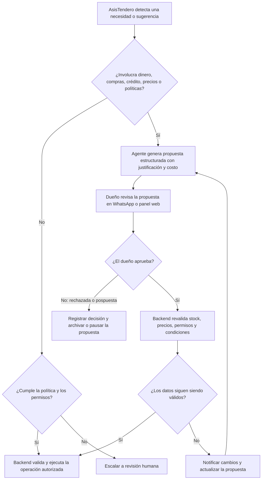
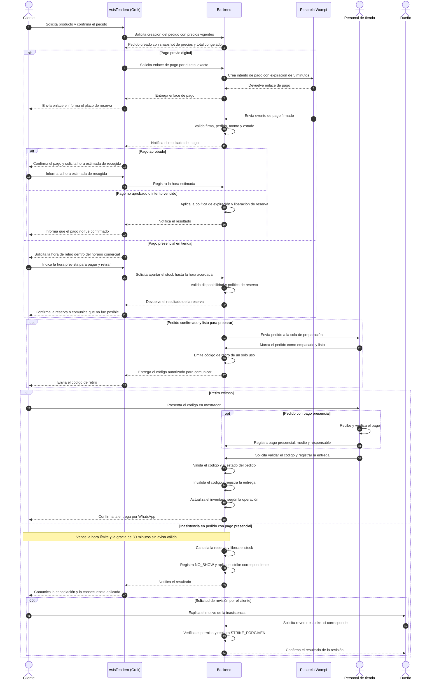

# PT-002 — Matriz de permisos y autonomía de AsisTendero

**Estado:** Borrador revisado para alineación del equipo.

**Versión:** 0.3, 13 de octubre de 2026.

**Dependencia:** Alineado con las decisiones de alcance y flujos de PT-001 v0.3, especialmente los recorridos de pedidos, identificación de productos, inventario y reposición.

---

## 1. Principio de autoridad y separación de poderes

AsisTendero, el agente conversacional basado en Grok, se encarga exclusivamente de tareas operativas y repetitivas: interpretar consultas y fotografías técnicas, consultar el catálogo, estructurar cotizaciones, coordinar reservas de stock según políticas explícitas, solicitar medios de pago, emitir recordatorios de retiro y redactar propuestas de reposición fundamentadas.

**Regla de inviolabilidad:** las decisiones comerciales, financieras y disciplinarias permanecen bajo la autoridad humana.

- **Precios y crédito:** fijar precios base, otorgar créditos o fiados y conceder descuentos extraordinarios.
- **Compras:** aprobar y emitir órdenes de compra a proveedores.
- **Políticas y penalizaciones:** modificar reglas del sistema, perdonar o revertir sanciones por inasistencia (*strikes*) y levantar suspensiones.
- **Operación física:** realizar el recuento físico de inventario, preparar pedidos, verificar el dinero recibido presencialmente y entregar la mercancía en mostrador corresponde al personal del establecimiento.

El modelo de lenguaje nunca ejecuta cambios directos en la base de datos ni dispone de herramientas de escritura irrestricta.

Grok propone acciones estructuradas mediante llamadas de herramientas (*tool calls*). Antes de ejecutar cualquier operación, el backend valida el negocio (`business_id`), el rol del actor, la política vigente, la idempotencia y el estado actual de la operación. Después de superar las validaciones correspondientes, el backend ejecuta y registra los cambios autorizados.

---

## 2. Roles del sistema

| Rol | Ámbito, atribuciones y límites |
|---|---|
| **Administrador de plataforma** | Responsable de la infraestructura, seguridad, creación de comercios y soporte técnico global. No tiene acceso ordinario ni lectura no autorizada de los datos comerciales internos de cada negocio. |
| **Dueño** | Máxima autoridad del comercio. Define precios y políticas de tolerancia y strikes, aprueba órdenes de compra, autoriza fiados presenciales y puede revertir sanciones. |
| **Encargado** | Coordina el turno y la operación diaria. Puede recibir delegaciones operativas temporales del dueño, pero no hereda facultades financieras ni la capacidad de modificar políticas globales. |
| **Empleado** | Personal de mostrador y bodega. Realiza búsquedas de apoyo, empaca pedidos, marca productos como listos, confirma cobros presenciales y valida códigos de retiro, según los permisos asignados. |
| **Agente AsisTendero (Grok + Tools)** | Agente conversacional que opera dentro de políticas predefinidas. Puede consultar información, coordinar tareas autorizadas y emitir propuestas, pero no autoriza compras, fiados ni modificaciones manuales de estados financieros. |
| **Servicio de Pagos (Backend Webhook)** | Componente transaccional del backend que valida la firma criptográfica, el monto y el estado del evento de Wompi para confirmar pagos digitales. |

---

## 3. Leyenda de permisos

| Código | Significado |
|---|---|
| **P — Permitido** | Acción autorizada por defecto dentro del propio negocio (`business_id`), sujeta a las validaciones lógicas del sistema. |
| **C — Condicionado** | Requiere cumplir una condición de negocio, validar el estado del pedido, obtener el consentimiento del cliente o contar con una delegación explícita. |
| **A — Aprobación requerida** | El agente o el personal subalterno solo pueden preparar una propuesta estructurada. El backend bloquea su ejecución hasta recibir la aprobación explícita y verificada de la autoridad correspondiente. |
| **D — Denegado** | Operación prohibida para ese rol. |

---

## 4. Matriz de permisos por rol y acción

La siguiente matriz define los permisos iniciales de cada rol. Todas las acciones permitidas o condicionadas deben pasar por las validaciones del backend.

| Acción en el sistema | Admin. plataforma | Dueño | Encargado | Empleado | AsisTendero (Grok) | Regla de verificación / justificación técnica |
|---|---|---|---|---|---|---|
| **GESTIÓN DE PLATAFORMA Y USUARIOS** | | | | | | |
| Crear o suspender comercios | P | D | D | D | D | Privilegio exclusivo de administración de la plataforma. |
| Gestionar usuarios y roles del comercio | D | P | C | D | D | El dueño gestiona su equipo; el encargado solo puede hacerlo bajo delegación explícita. |
| **CATÁLOGO, PRECIOS Y COTIZACIÓN** | | | | | | |
| Consultar catálogo y stock comercial disponible | D | P | P | P | P | Consulta para cotización y venta asistida. |
| Consultar stock exacto interno o de anaquel | D | P | P | C | C | El agente puede consultar el inventario interno para informar la disponibilidad autorizada. |
| Crear o editar productos y atributos técnicos | D | P | C | C | A | El agente prepara un borrador de ficha; un humano autorizado confirma los cambios. |
| Cambiar precio base, impuesto o regla de cobro | D | P | D | D | A | El agente puede proponer cambios, pero el dueño debe autorizarlos. |
| Cotizar y congelar el precio en la orden (*snapshot*) | D | P | P | P | P | El backend conserva el precio unitario acordado al confirmar el pedido. |
| Autorizar descuentos fuera de política | D | P | D | D | A | Requiere aprobación explícita del dueño antes de aplicar el descuento. |
| **RESERVAS, TIEMPOS E INASISTENCIAS** | | | | | | |
| Reservar stock para pago digital (5 minutos) | D | P | P | C | C | La reserva se aplica durante el intento de pago, según las reglas definidas para la pasarela. |
| Apartar stock para pago en tienda | D | P | P | C | C | Se establece una hora límite de retiro (`pickup_deadline`) según el horario comercial y las políticas del negocio. |
| Ampliar el tiempo de recogida por aviso del cliente | D | P | P | P | C | El agente puede extender la ventana si el cliente avisa dentro del plazo y se cumplen las condiciones de la política. |
| Registrar inasistencia (`NO_SHOW`) y sumar strike | D | P | P | P | C | El backend aplica la regla al vencer el plazo de gracia. El personal puede registrar una incidencia según sus permisos. |
| Revertir strike o levantar suspensión | D | P | D | D | D | Acción exclusiva del dueño, con registro de auditoría. |
| **PAGOS Y TRANSACCIONES** | | | | | | |
| Generar enlace Wompi vinculado al pedido | D | P | C | D | C | El backend genera un enlace de pago asociado al pedido y al monto congelado. |
| Marcar pago digital como aprobado | D | D | D | D | D | Exclusivo del servicio de pagos del backend, mediante validación del evento firmado o consulta autorizada a la pasarela. |
| Confirmar pago presencial en tienda | D | P | P | P | D | El personal autorizado verifica el dinero recibido o la transferencia. |
| **PREPARACIÓN, CÓDIGO Y ENTREGA FÍSICA** | | | | | | |
| Marcar pedido empacado y listo para retiro | D | P | P | P | D | Requiere una acción física del personal. |
| Comunicar código de entrega de un solo uso | D | P | P | C | P | AsisTendero puede comunicar el código emitido por el backend, sin modificar su validez. |
| Validar código y confirmar entrega física | D | P | P | P | D | El personal valida el código y realiza la entrega. El backend registra la operación y actualiza el inventario según el flujo definido. |
| **INVENTARIO, COMPRAS Y REPOSICIÓN** | | | | | | |
| Monitorear stock bajo y preparar propuesta de reposición | D | P | P | C | P | El agente analiza el inventario y presenta una propuesta fundamentada. |
| Aprobar y emitir orden de compra a proveedor | D | P | D | D | A | El agente prepara la propuesta; el dueño debe aprobar la compra antes de emitir la orden. |
| Registrar recepción física de mercancía | D | P | P | C | D | El personal verifica las unidades recibidas antes de actualizar el stock físico. |
| Ajustar inventario por merma o daño | D | P | C | C | D | Se requiere registrar el motivo del ajuste y la persona responsable. |
| **CRÉDITOS Y FIADOS** | | | | | | |
| Preparar solicitud y consultar saldo de fiado | D | P | C | C | C | El agente consulta información existente y autorizada; no concede crédito. |
| Autorizar entrega fiada o crédito en tienda | D | P | D | D | A | El agente solo prepara la solicitud. La autorización corresponde al dueño y debe registrarse. |
| Registrar abono de fiado recibido en caja | D | P | P | C | D | El personal autorizado registra el abono recibido y el medio de pago correspondiente. |

**Notas de interpretación:**

- `A` no significa que AsisTendero pueda ejecutar la acción por su cuenta. Significa que puede preparar una propuesta que requiere aprobación.
- `C` no concede permisos generales. La operación solo se permite cuando se cumplen las condiciones establecidas y el backend las verifica.
- El permiso `P` tampoco permite saltarse las validaciones del backend.
- La autorización de una acción comercial no sustituye las verificaciones técnicas, financieras o de estado requeridas para ejecutarla.

---

## 5. Puertas de decisión y ciclo de propuestas

Cuando una acción propuesta por AsisTendero involucra compromisos de capital, modificación de precios, compras a proveedores, excepciones crediticias o cambios de políticas, se activa la compuerta de aprobación correspondiente.

### Reglas del ciclo de aprobación

1. **Contenido de la propuesta:** cada propuesta debe especificar los datos pertinentes para la decisión. Para una reposición de inventario, incluirá como mínimo:

   - SKU y nombre del producto.
   - Cantidad sugerida.
   - Costo unitario y costo total estimado.
   - Proveedor recomendado, si se conoce.
   - Plazo estimado de entrega, si está disponible.
   - Justificación basada en datos observables, por ejemplo: «Quedan 2 unidades y se venden aproximadamente 15 unidades por semana».

2. **Revalidación antes de ejecutar (*check-then-act*):** si entre la creación de la propuesta y su aprobación cambian el precio, el stock, las condiciones del proveedor o cualquier dato relevante, el backend debe impedir la ejecución con datos obsoletos.

3. **Nueva ratificación:** si los cambios modifican las condiciones económicas o el alcance de la propuesta aprobada, el dueño debe revisar y aprobar nuevamente las condiciones actualizadas.

4. **Registro de auditoría:** el sistema debe conservar la propuesta, su versión, los datos utilizados, la identidad de quien aprobó o rechazó y el resultado de la operación.

5. **Idempotencia:** repetir una solicitud o recibir nuevamente el mismo evento no debe provocar compras, cobros ni cambios duplicados.

---

## 6. Separación de poderes en pedidos, pagos y control de inasistencias

El siguiente diagrama representa el ciclo transaccional de un pedido, diferenciando el pago digital mediante Wompi del pago presencial en mostrador y contemplando el control de inasistencias (*strikes*).

**Consideraciones del flujo:**

- El enlace de pago no constituye por sí mismo una confirmación de pago.
- El agente no puede declarar aprobado un pago digital.
- La preparación y la entrega física requieren intervención del personal.
- El código de retiro debe ser de un solo uso y validarse contra el estado actual del pedido.
- El vencimiento de una reserva y la aplicación de un strike son eventos diferentes: cada uno debe obedecer su propia regla.
- La cancelación, la liberación del stock y la actualización del pedido deben ejecutarse de forma consistente para evitar reservas duplicadas o inventario incorrecto.

---

## 7. Políticas de conciliación de pagos e inasistencias

### A. Conciliación y registro de pagos

**1. Pagos digitales (Wompi y otros medios integrados)**

La aprobación de pagos digitales corresponde exclusivamente al servicio de pagos del backend, que debe validar el evento firmado o realizar una consulta autorizada a la pasarela.

Ningún usuario humano ni el agente pueden forzar manualmente el estado `PAID_DIGITAL`. Una captura de pantalla enviada por el cliente no constituye confirmación suficiente del pago.

La integración debe verificar, según las capacidades de la pasarela:

- La autenticidad del evento recibido.
- La correspondencia con el intento de pago y el pedido.
- El monto y la moneda esperados.
- El estado definitivo de la transacción.
- La idempotencia del procesamiento del evento.

**2. Pagos presenciales en mostrador**

El empleado, encargado o dueño autorizado recibe el dinero en efectivo o verifica el comprobante del datáfono o la transferencia local.

Al confirmar un pago presencial, el backend registra como mínimo:

- El pedido asociado.
- El medio de pago.
- El monto recibido.
- El usuario responsable de la confirmación.
- La fecha y hora del registro.

La confirmación presencial no debe habilitar la entrega si el pedido no cumple las demás condiciones necesarias.

### B. Régimen de inasistencias (*strikes*)

**1. Gatillo de inasistencia**

La inasistencia se activa únicamente en pedidos con pago presencial cuando vence la hora pactada de retiro más el tiempo de gracia predeterminado de 30 minutos, sin que el cliente haya acudido ni solicitado una prórroga válida.

**2. Prórroga conversacional**

Si el cliente informa una demora antes de vencer el plazo y se cumplen las condiciones de la política, AsisTendero puede extender la ventana de recogida una sola vez.

La extensión debe quedar registrada en el backend. No debe crear una reserva indefinida ni permitir ampliaciones ilimitadas.

**3. Escalamiento de consecuencias**

| Número de strike | Consecuencia |
|---|---|
| **Strike 1** | Notificación informativa de cancelación del pedido y advertencia al cliente. |
| **Strike 2** | Restricción del pago presencial: los siguientes pedidos por el canal de chat requieren pago previo digital. |
| **Strike 3** | Suspensión de la creación de nuevos pedidos por el canal de chat hasta que el dueño revise y levante la restricción, si corresponde. |

Las consecuencias deben aplicarse a partir del historial registrado por el backend, no de una decisión discrecional del modelo de lenguaje.

**4. Reversión de sanciones**

El dueño es el único rol autorizado para revertir un strike injustificado o levantar una suspensión desde el tablero web.

La reversión debe registrar el evento `STRIKE_FORGIVEN`, el responsable, la fecha, el motivo y la sanción afectada. El historial de auditoría debe conservar el registro original y su reversión, sin borrar los acontecimientos previos.

---

## 8. Verificaciones y dependencias para cierre de PT-002

### Verificaciones de alcance

- [x] **Diferenciación de reservas:** se separa el plazo de 5 minutos del intento de pago digital de la hora pactada para el retiro presencial.
- [x] **Separación de pagos:** el pago digital se confirma mediante el servicio de pagos del backend; el presencial se registra por personal autorizado.
- [x] **Manejo de inasistencias:** se contempla la prórroga conversacional, el escalamiento de strikes y la reversión exclusiva por el dueño.
- [x] **Ciclo de propuestas:** se contempla la aprobación humana, la revalidación de datos y la actualización de propuestas cuyas condiciones hayan cambiado.
- [x] **Formato de diagramas:** los diagramas se presentan en bloques Mermaid para su visualización en editores compatibles.
- [x] **Consistencia de permisos:** se define la reversión de sanciones como una acción exclusiva del dueño, sin permiso ordinario para el encargado.

### Pendientes operativos

- [ ] **Comercio piloto:** determinar con la ferretería seleccionada el horario comercial de retiro y el monto máximo permitido para apartar pedidos sin pago previo.
- [ ] **Delegaciones:** definir si el encargado podrá recibir delegaciones adicionales y cuáles serán sus límites, sin asumir que obtiene automáticamente facultades del dueño.
- [ ] **Pagos:** confirmar los medios de pago que se integrarán en el MVP y cuáles requerirán validación manual.
- [ ] **Inasistencias:** validar con el comercio piloto el tiempo de gracia de 30 minutos, las consecuencias de los tres strikes y las condiciones para solicitar una revisión.

### Pendientes técnicos

- [ ] **PT-006 — Herramientas del agente:** especificar las firmas de las herramientas (*tools*) para consultar catálogo e inventario, emitir cotizaciones, gestionar reservas y enviar propuestas al panel del dueño.
- [ ] **Autorización:** definir cómo se comprobarán los roles, las delegaciones, el consentimiento y las aprobaciones en el backend.
- [ ] **Auditoría:** definir el esquema de registro de acciones, aprobaciones, rechazos, pagos, entregas y reversión de sanciones.
- [ ] **Transacciones e idempotencia:** especificar cómo se evitarán operaciones duplicadas y cómo se mantendrá la consistencia entre pedidos, reservas, pagos e inventario.
- [ ] **Seguridad de herramientas:** garantizar que Grok no pueda saltarse las validaciones del backend ni ejecutar operaciones fuera de las herramientas autorizadas.

---

**Criterio de cierre:** PT-002 podrá considerarse aprobado cuando el equipo valide la matriz de permisos, las reglas de autorización, las políticas operativas pendientes y su coherencia con PT-001. Los detalles de implementación de las herramientas y validaciones se documentarán en PT-006.