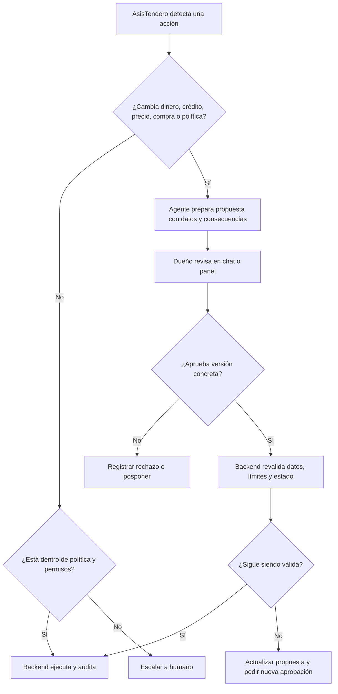
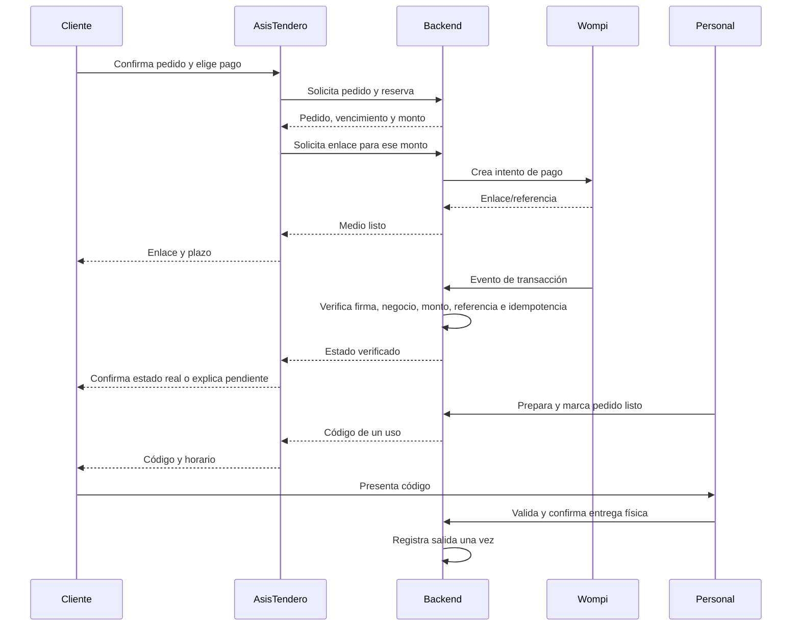

# PT-002 — Matriz de permisos y autonomía de AsisTendero

**Estado:** borrador para revisión conjunta, dependiente de PT-001. **Versión:** 0.2, 12 de octubre de 2026. **Criterio de la issue:** matriz para administrador de plataforma, dueño, encargado, empleado y agente, con compras, fiados, descuentos y devoluciones. Las políticas aquí descritas **no están implementadas**.

## 1. Principio de autoridad

AsisTendero lleva la mayor parte del **trabajo repetitivo**: interpreta mensajes y fotos, consulta datos, arma cotizaciones, registra pedidos válidos, sigue pagos y plazos, recuerda citas, detecta faltantes, prepara propuestas y explica qué ocurrió. Las **decisiones comerciales importantes** son humanas: fijar o cambiar precio, dar crédito, aprobar compras a proveedores, descuentos fuera de política, devoluciones excepcionales, ajustes de inventario relevantes y cambios de reglas. El personal realiza acciones físicas: contar mercancía, preparar pedidos, recibir efectivo y entregar.

El modelo propone una llamada de herramienta; **el backend verifica el negocio, actor, política, estado y parámetros** antes de ejecutarla. Una frase del cliente, un prompt o una imagen nunca otorgan permisos. Los eventos de Wompi son procesados por un servicio técnico distinto del agente.

## 2. Roles

| Rol | Ámbito y límites |
|---|---|
| Administrador de plataforma | Alta, soporte y seguridad de la plataforma; sin acceso ordinario a datos privados de tiendas. Soporte excepcional con autorización y auditoría. |
| Dueño | Autoridad comercial del negocio; define políticas, usuarios, precios y aprobaciones sensibles. |
| Encargado | Coordina operación diaria; puede recibir delegaciones específicas, con límite y vencimiento. No hereda automáticamente poder de dueño. |
| Empleado | Catálogo, preparación, recepción y entrega dentro de funciones asignadas; sin decisiones financieras extraordinarias. |
| Agente AsisTendero | Accede a herramientas limitadas para consultar, proponer y ejecutar pasos rutinarios permitidos. No firma decisiones sensibles. |

El **cliente** es actor externo con acceso a su conversación y pedido. El **servicio de pagos** puede confirmar eventos validados, pero tampoco es un rol humano ni un permiso del modelo. Un usuario que administra dos negocios debe elegir y verificar el contexto antes de cada acción.

## 3. Leyenda

- **P:** permitido por defecto dentro de su propio negocio y sujeto a validaciones técnicas.
- **C:** condicionado a política previa, estado, consentimiento del cliente o delegación explícita; la decisión actual no es unilateral.
- **A:** requiere aprobación humana puntual para esa operación; el agente puede preparar la solicitud, pero no ejecutarla sin aprobación.
- **D:** denegado para ese rol.

`A` no autoriza a Grok a sustituir al humano: especifica que puede **preparar** una acción y reanudarla después de recibir una aprobación verificable. En código, `P` y `C` siguen sujetos a `business_id`, permisos y auditoría.

## 4. Matriz rol × acción propuesta

| Acción | Admin. plataforma | Dueño | Encargado | Empleado | AsisTendero |
|---|:---:|:---:|:---:|:---:|:---:|
| Crear o suspender negocio en la plataforma | P | D | D | D | D |
| Gestionar usuarios y delegaciones del negocio | D | P | C | D | D |
| Consultar catálogo y disponibilidad comercial | D | P | P | P | P |
| Consultar stock exacto interno | D | P | P | C | C |
| Crear/editar producto o foto oficial | D | P | C | C | A |
| Cambiar precio, impuesto o promoción base | D | P | D | D | A |
| Aplicar promoción vigente calculada por backend | D | P | P | C | C |
| Autorizar descuento extraordinario | D | P | D | D | A |
| Interpretar foto y sugerir SKU | D | P | P | P | P |
| Cotizar con precio vigente | D | P | P | P | P |
| Crear pedido de cliente confirmado | D | P | P | P | C |
| Reservar stock 5 minutos dentro de política | D | P | P | C | C |
| Extender reserva 5 minutos tras confirmación del cliente | D | P | P | C | C |
| Crear enlace Wompi vinculado al pedido | D | P | C | D | C |
| Marcar pago digital como aprobado | D | D | D | D | D |
| Confirmar pago presencial comprobado | D | P | C | C | D |
| Preparar pedido y marcar listo | D | P | P | P | D |
| Enviar código de recogida ya emitido por backend | D | P | P | C | P |
| Confirmar entrega física | D | P | P | P | D |
| Solicitar ajuste de inventario por anomalía | D | P | P | C | A |
| Ejecutar ajuste de stock/merma | D | P | C | C | D |
| Registrar recepción física de proveedor | D | P | P | C | D |
| Analizar demanda y preparar reposición | D | P | P | C | P |
| Aprobar y emitir compra a proveedor | D | P | D | D | A |
| Preparar solicitud de fiado | D | P | C | C | C |
| Autorizar fiado y entrega a crédito en local | D | P | D | D | A |
| Registrar abono de fiado comprobado | D | P | C | C | D |
| Preparar solución de pago tardío o devolución | D | P | P | C | C |
| Aprobar devolución/reintegro extraordinario | D | P | D | D | A |
| Consultar reportes internos del negocio | D | P | P | C | C |
| Cambiar políticas de agente, reserva o pago | D | P | D | D | A |

**Precisiones para no interpretar mal la tabla:**

1. El acceso `C` de AsisTendero al stock exacto es **interno** para decidir disponibilidad; al cliente comunica «hay/no hay» o una cantidad comercial autorizada, no el saldo exacto por defecto.
2. En «crear/editar producto» y «cambiar precio», `A` significa que el agente puede **redactar una propuesta**. Solo el dueño, o quien tenga delegación definida, ejecuta el cambio. No debe existir una herramienta de escritura directa del modelo para esa acción.
3. Para crear pedido, reserva, enlace y extensión, el backend verifica intención/confirmación del cliente, stock, precio y vigencia. El agente no decide sobrepasar las reglas.
4. Ningún humano «marca» un pago digital como aprobado manualmente: el **servicio de pagos** registra el estado tras verificar firma/evento o consulta de transacción y conciliar negocio, referencia e importe. Un pago presencial sí requiere registro humano del hecho recibido. Una transferencia externa sin integración sigue un procedimiento de verificación humana distinto y se identifica como tal.
5. La aprobación de compra a proveedor permanece en el dueño por defecto, conforme a lo expresado anteriormente por los usuarios. Si se quiere delegar, debe ser una decisión posterior explícita.
6. El fiado se autoriza presencialmente. El agente puede preparar la solicitud y registrar el estado después de la confirmación humana, pero nunca conceder crédito ni prometerlo al cliente.
7. `A` en devolución implica propuesta o gestión del caso. La aprobación, la ejecución del reintegro y la confirmación de Wompi son hechos separados. Para reglas automáticas de bajo importe, la pareja debe decidir un límite explícito antes de permitirlas.

## 5. Puertas de decisión

Una propuesta muestra datos utilizados, fecha, cálculo, incertidumbre y efecto. La aprobación contiene actor, negocio, alcance, cantidad, versión, hora y vencimiento. Si el precio o stock cambió, se revalida. La acción externa se ejecuta de forma idempotente para que un reintento o doble mensaje no compre, cobre o entregue dos veces.

## 6. Pago, reserva y entrega: separación de poderes

El backend puede liberar automáticamente una reserva no pagada al vencer. La ampliación inicial de cinco minutos requiere confirmación del cliente; el número máximo de ampliaciones queda por definir en PT-003. La recogida posterior y su reprogramación tienen política distinta para pedidos ya pagados. Un pago que llega después de liberar stock abre excepción: verificar nuevo stock y ofrecer cumplimiento, alternativa aceptada o devolución bajo control humano donde corresponda.

## 7. Pendientes antes de cerrar PT-002

- Confirmar con la pareja y el comercio si el **encargado** puede recibir delegaciones para descuentos, ajustes, devoluciones o fiados, y sus límites; esta matriz usa dueño como autoridad por defecto.
- Definir si el empleado puede confirmar pagos presenciales y abonos o solo el encargado.
- Determinar quién emite y comunica el código, cómo se verifica identidad y qué hacer si el cliente lo pierde.
- Definir umbrales de ajuste de inventario y devolución que exigen aprobación puntual.
- Validar modalidad de cuenta Wompi por negocio y canal de eventos; PT-008 también debe resolver WhatsApp oficial.
- Definir en PT-003 estados y transiciones; en PT-004, movimientos exactos; en PT-006, herramientas autorizadas. Esta matriz guía esas tareas, pero no las sustituye.

**Criterio de revisión de esta issue:** la pareja acepta la leyenda, los cinco roles, cada fila sensible, las delegaciones y los casos donde el agente solo propone. Hasta entonces PT-002 permanece «En definición».

