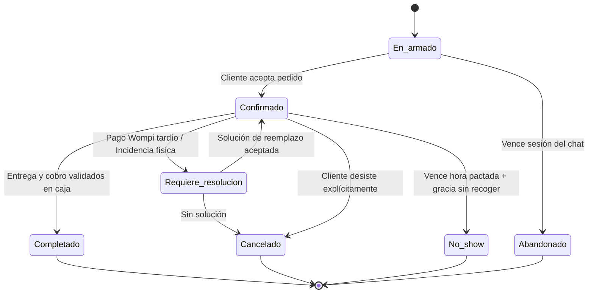
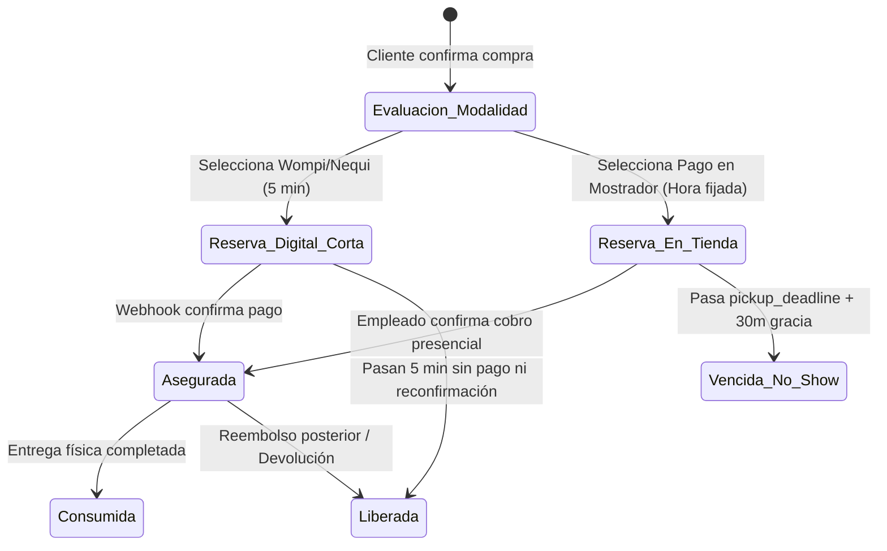
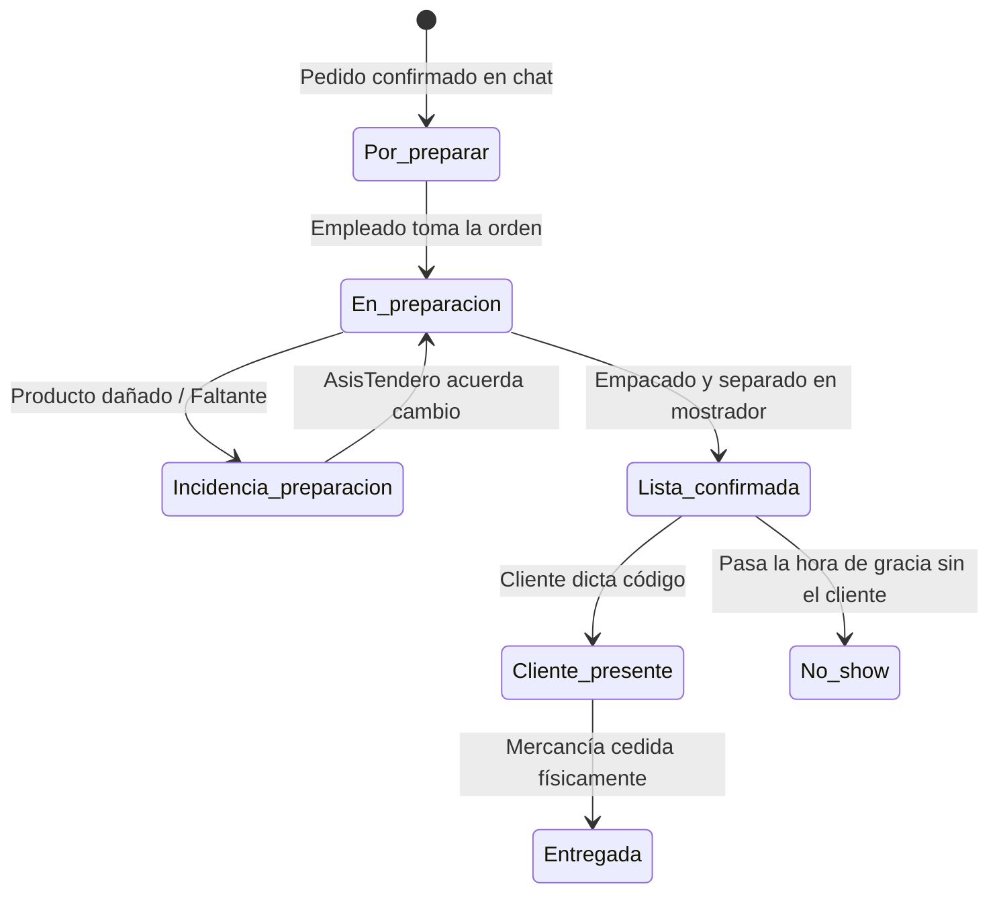

---

# PT-003 — Estados de pedido, pago, reserva, fiado y devolución

**Estado:** Borrador revisado para alineación del equipo.

**Versión:** 0.3, 13 de octubre de 2026.

**Dependencia:** Alineado con [PT-001 v0.3] y la matriz de permisos [PT-002 v0.3].

## 1. Propósito y separación de estados

Esta definición convierte las operaciones del comercio en reglas observables y modulares. Un pedido no tiene un estado único gigante; se compone de variables independientes: el **pedido** (compromiso comercial), la **reserva** (bloqueo temporal de inventario), el **pago** (obligación financiera) y la **preparación/entrega** (flujo físico).

**[ACORDADO]** Se implementan dos modalidades estrictas de reserva: una corta (5 minutos) para pasarelas digitales y una prolongada (ventana de entrega) para pagos presenciales. Se consolida el estado `no_show` para castigar inasistencias y se elimina la burocracia de confirmación manual de citas para agilizar el mostrador.

## 2. Lenguaje visible en el panel del comercio

La interfaz combina los estados internos para mostrar etiquetas fáciles de entender para el ferretero o tendero:

| Etiqueta visible | Condición interna | Significado operativo |
| --- | --- | --- |
| En armado | Pedido `en_armado` | El cliente está agregando productos al chat. No hay reserva. |
| Por preparar | Pedido `confirmado`; Preparación `por_preparar` | El cliente aceptó el total. Falta empacar los artículos. |
| Preparando | Preparación `en_preparacion` | El personal está alistando la orden físicamente. |
| Por recoger · pagado | Pago `pagado`; Preparación `lista_confirmada` | Dinero asegurado y paquete listo. Solo falta que el cliente pase a retirar. |
| Por recoger · pago en tienda | Pago `pendiente`; Reserva `reserva_en_tienda` | Paquete listo. El cliente debe pagar en el mostrador antes de la hora límite. |
| Pendiente de pago digital | Pago `pendiente`; Reserva `reserva_digital_corta` | Paquete en pausa. El cliente tiene 5 minutos para completar el pago Wompi. |
| Incidencia de preparación | Preparación `incidencia_de_preparacion` | Faltan productos físicos frente al stock teórico. Requiere resolución. |
| Entregado | Entrega `entregada`; Pago `pagado` | El personal validó el código, cobró y entregó el paquete. |
| Inasistencia (No-Show) | Pedido `no_show` | El cliente no se presentó a la hora acordada. Se cancela orden y suma strike. |

## 3. Estado del Pedido: Intención y compromiso

El estado principal del pedido refleja el ciclo de vida del acuerdo comercial.

| Estado interno | Transiciones permitidas | Detalle |
| --- | --- | --- |
| `en_armado` | `confirmado`, `abandonado` | Agente cotiza productos. |
| `confirmado` | `completado`, `cancelado`, `no_show`, `requiere_resolucion` | Se congela el precio (*snapshot*) y se activan reservas. |
| `requiere_resolucion` | `confirmado`, `cancelado` | Discrepancia por pago tardío o falta de stock físico. |
| `completado` | Ninguna (Estado final) | Mercancía entregada y pagada (o fiada por el dueño). |
| `cancelado` | Ninguna (Estado final) | Desistimiento explícito del cliente o falta de pago digital. |
| `no_show` | Ninguna (Estado final) | Inasistencia penalizada al vencer la hora de retiro en tienda. |

## 4. Arquitectura de Reservas e Inventario

Para evitar bloqueos fantasma, el sistema separa de inmediato las reservas según la elección de pago del cliente.

| Tipo de Reserva | Duración y Regla | Salida |
| --- | --- | --- |
| `reserva_digital_corta` | **5 minutos**. Exclusiva para pago por Wompi/Nequi. | Pago aprobado → `asegurada`. Vencimiento sin pago → `liberada` (cancela pedido). |
| `reserva_en_tienda` | Hasta la **hora límite pactada (`pickup_deadline`)** más 30 min de gracia. | Llegada y cobro → `asegurada`. Vencimiento → `vencida_no_show`. |
| `asegurada` | El stock ya está pagado o el cliente ya está en mostrador. | Entrega física → `consumida`. |

## 5. Estado de Pago: Obligación e Intentos

Un pago digital fallido no mata el pedido, permite reintentos. Un pago presencial solo se asienta si el personal lo corrobora en caja.

| Estado Agregado | Origen | Actor que lo modifica |
| --- | --- | --- |
| `pendiente` | Defecto al crear pedido. | Backend. |
| `en_verificacion` | Conciliando webhook de Wompi. | Servicio interno de Pagos. |
| `pagado` | Evento criptográfico aprobado o efectivo validado. | Wompi (digital) o Empleado (presencial). |
| `fiado` | Cuenta por cobrar. | Dueño en persona. |
| `reembolso_pendiente` | Cancelación posterior a un cobro. | Backend tras escalar a dueño. |

## 6. Preparación y Entrega (Flujo Físico Ágil)

Se elimina la confirmación burocrática de citas. Si el cliente dice que llega a las 5:00 PM, el pedido entra a la cola de preparación para estar listo antes de esa hora.

*Nota: AsisTendero solo le avisa al cliente "Tu pedido está listo para recoger" cuando el estado alcanza `lista_confirmada`. Nunca lo promete de inmediato.*

## 7. Fiados y Reembolsos (Excepciones)

* **Fiado:** Proceso 100% presencial. Si el cliente solicita fiado, el pedido se aparta pero el estado de pago muta a `fiado` solo cuando el dueño lo aprueba físicamente en el local.
* **Devolución:** Separada en dos dimensiones. El producto físico lo recibe el empleado (`producto_recibido`). El dinero lo autoriza exclusivamente el dueño (`reintegro_aprobado`) y el Backend ejecuta la orden hacia Wompi o la caja registradora.

## 8. Escenarios Críticos a Soportar

1. **Digital exitoso:** Confirma pedido → `reserva_digital_corta`. Paga Nequi. Webhook Wompi llega → `pagado` y reserva `asegurada`. Cliente avisa que llega a las 3:00 PM. Empleado alista (`lista_confirmada`). Cliente recoge.
2. **Inasistencia a tienda:** Confirma pedido para pagar a las 4:00 PM. Empleado alista el paquete. Dan las 4:30 PM (fin de gracia) y el cliente no avisó por chat. Backend cambia pedido a `no_show`, suma 1 strike al cliente, libera el stock para venta y deshace el paquete físico.
3. **Pago digital tardío:** La `reserva_digital` expiró a los 5 minutos y se liberó el inventario. A los 10 minutos entra el pago retrasado de Nequi. El backend captura el pago (`pagado`) pero pone el pedido en `requiere_resolucion` para verificar si aún queda stock de ese SKU.

## 9. Decisiones Cerradas frente a PT-001 y PT-002

| Aspecto | Definición Acordada | Estado |
| --- | --- | --- |
| **Modalidad de Reserva** | Separada: 5 min para digital, y hora fijada para tienda. | **[ACORDADO]** |
| **Inasistencias** | Estado independiente (`no_show`) que dispara strikes automáticos. | **[ACORDADO]** |
| **Agendamiento** | Simplificado: *pickup_deadline* automático sin aprobación humana extra. | **[ACORDADO]** |
| **Autoridad Fiado/Reembolso** | Dueño (o delegado). AsisTendero no tiene acceso de escritura. | **[ACORDADO]** |

---

