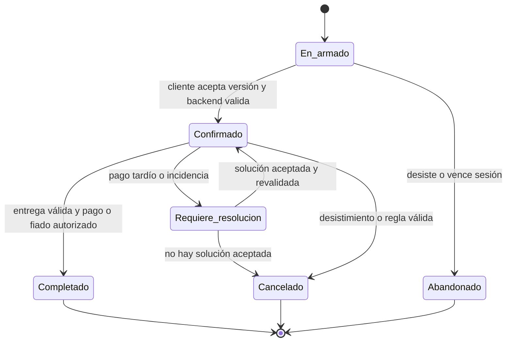
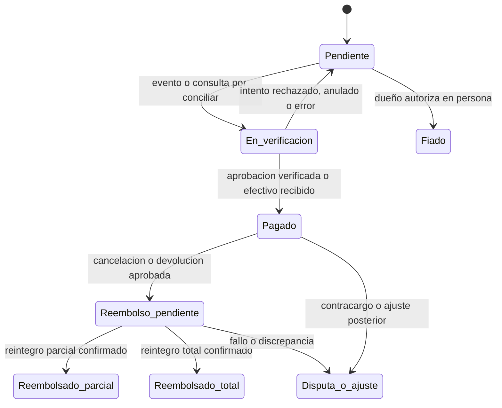
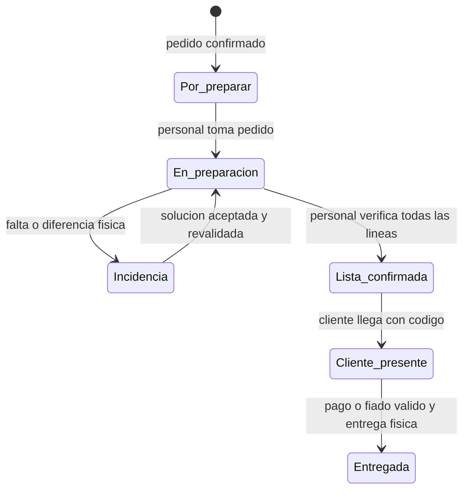
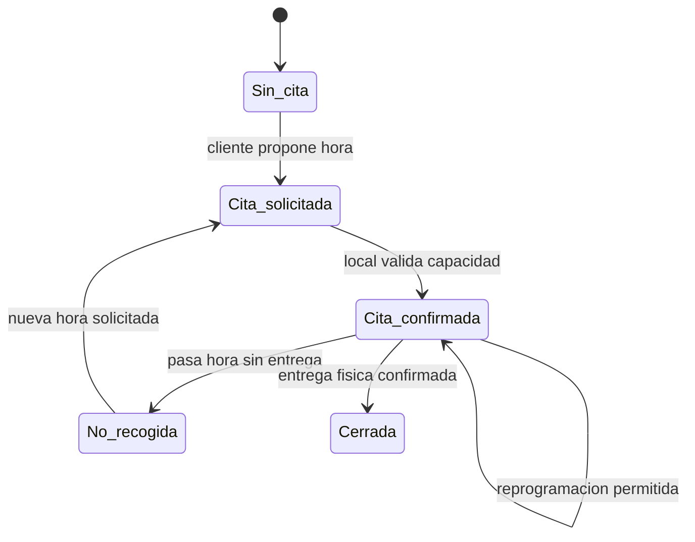

# PT-003 — Estados de pedido, pago, recogida, fiado y devolución

**Estado:** propuesta para revisión de los dos integrantes; no implementada ni cerrada. **Versión:** 0.2, 13 de octubre de 2026 (America/Bogota). **Issue:** [PT-003](https://github.com/JulianCVM/AsisTendero/issues/2). **Dependencia:** PT-001 y la matriz PT-002, ambas todavía en definición.

## 1. Propósito y criterio de aceptación

Esta definición convierte las situaciones descritas por la pareja en reglas observables: un pedido puede estar **por recoger y pagado** o **por recoger y pendiente de pago**, sin que un solo campo intente representar ambos hechos. El criterio registrado para PT-003 es: **diagramas con transiciones, actor autorizado, caducidad y manejo de pagos tardíos**. Los diagramas y tablas de este documento proponen cómo cumplirlo; la pareja debe ratificar los puntos abiertos de la sección 12 antes de dar por cerrada la issue.

**[ACORDADO por los usuarios]** La compra puede pagarse anticipadamente por una pasarela sencilla, con Wompi/Nequi como opción principal, o presencialmente. Hay reserva inicial de cinco minutos, aviso al cliente al aproximarse o cumplirse ese plazo, posibilidad de confirmar que aún comprará, código de retiro, recogida posterior acordada, fiado autorizado presencialmente y devolución registrada por el tendero. Para pedidos grandes, el tendero confirma que reunió y revisó toda la orden antes de avisar que está lista para recoger; el cliente debe poder pasar sin esperar a que se arme el pedido. El pago digital nunca se confirma por captura o por declaración del cliente. El agente acompaña las excepciones y el dueño decide los compromisos sensibles.

**[PROPUESTO aquí]** Usar registros con estados propios para **pedido**, **reserva de inventario**, **pago e intentos de pago**, **recogida/entrega** y, cuando aplique, **fiado** y **devolución**. La interfaz muestra etiquetas fáciles a partir de esas combinaciones. Así se conserva la historia y se evita que «entregado» signifique equivocadamente «pagado».

## 2. Lenguaje que verá el negocio

| Texto visible | Condición interna propuesta | Qué significa |
|---|---|---|
| En proceso | Pedido `en_armado` | El cliente todavía está eligiendo o corrigiendo productos. No hay compromiso de compra. |
| Compra confirmada · por preparar | Pedido `confirmado`; preparación `por_preparar` | El cliente aceptó productos y precio; el sistema validó disponibilidad lógica. Falta comprobar y reunir físicamente los artículos. |
| Preparando · pagado o pago pendiente | Preparación `en_preparacion`; pago se muestra por separado | El personal alista el pedido. El cliente aún no debe recibir «ya puedes recoger». |
| Por recoger · pagado | Pedido `confirmado`; pago `pagado`; preparación `lista_confirmada` | El dinero y la preparación física están confirmados; falta la entrega. |
| Por recoger · pago pendiente | Pedido `confirmado`; pago `pendiente`; preparación `lista_confirmada` | El pedido está listo, pero deberá pagarse en local o confirmarse por pasarela antes de entregarlo. |
| En espera de confirmación | Reserva `gracia_de_confirmacion` | Se avisó que acaba el plazo inicial; falta respuesta antes de decidir si extender o liberar. |
| Recogida programada | Existe `pickup_at` y estado de cita `confirmada` | Hay hora acordada; preparación y pago se muestran por separado. La cita por sí sola no significa «listo». |
| Falta un artículo | Preparación `incidencia_de_preparacion` | El personal encontró diferencia física; AsisTendero gestiona una solución antes de citar al cliente como listo. |
| Recogido · pagado | Entrega `entregada`; pago `pagado` | El personal validó el código, entregó y comprobó el pago. |
| Recogido · fiado | Entrega `entregada`; cuenta por cobrar `vigente` | El dueño autorizó presencialmente la entrega a crédito. Queda saldo por cobrar. |
| Cancelado · reembolso pendiente | Pedido `cancelado`; pago original `pagado`; devolución monetaria `pendiente` | La compra terminó, pero el dinero todavía no volvió al cliente. |

Estas etiquetas **no** son un campo único de base de datos. La fecha de recogida tampoco equivale a duración de reserva: pueden coexistir una cita posterior y una reserva cuyo vencimiento se rige por política. **«Pagado» y «confirmado» nunca equivalen a «listo para recoger».**

## 3. Pedido: intención y compromiso

| Estado interno | Entrada | Salidas permitidas | Actor que inicia / condición |
|---|---|---|---|
| `en_armado` | Cliente empieza a consultar o agregar productos | `confirmado`, `abandonado` | Cliente expresa compra; AsisTendero cotiza y solicita creación; backend revalida precio, SKU, cantidad y disponibilidad. |
| `confirmado` | Cliente acepta versión concreta del pedido | `completado`, `cancelado`, `requiere_resolucion` | Backend crea versión inmutable de líneas y total; cambios posteriores requieren recotización. |
| `requiere_resolucion` | Pago tardío, falta stock, discrepancia o incidencia | `confirmado`, `cancelado` | Backend detecta; agente comunica opciones; cliente elige; humano aprueba excepción económica si corresponde. |
| `completado` | Entrega física válida y obligación de pago satisfecha **o fiado autorizado** | Sin salida ordinaria | Backend después de evento de entrega. Una devolución posterior abre caso separado; no reescribe la entrega. |
| `cancelado` | Cliente desiste o se aplica una regla válida de caducidad/cancelación | Sin reactivar el mismo pedido | Cliente, dueño o backend según política; si hubo cobro, se abre flujo de reintegro. |
| `abandonado` | Nunca hubo confirmación de compra | Sin salida ordinaria | Cliente o vencimiento de sesión bajo política; no hay cobro ni entrega. |

La expresión del usuario «cuando confirma que sí va a comprar» corresponde a `confirmado`. No se infiere esa confirmación de una pregunta sobre precio o de que el cliente abra un enlace de pago. **[PROPUESTO]** El pedido queda `completado` cuando sale físicamente; si fue fiado, el saldo vive en una cuenta por cobrar independiente y puede seguir pendiente.



## 4. Reserva y caducidad: los cinco minutos

La reserva representa unidades comprometidas temporalmente. **Confirmar el pedido no descuenta por sí solo el stock físico.** Los movimientos exactos pertenecen a PT-004. El backend asigna `reserved_until` con hora del servidor y bloquea la sobreventa mediante operación atómica.

| Estado | Regla propuesta | Salida y responsable |
|---|---|---|
| `activa` | Reserva inicial de **5 minutos** desde la confirmación y validación de stock. | Al pagar y confirmar conservación de unidades → `asegurada`; ante aviso de vencimiento → `gracia_de_confirmacion`; cancelación → `liberada`. Backend. |
| `gracia_de_confirmacion` | AsisTendero avisa cerca del vencimiento o al cumplirse: «¿Aún quieres el pedido? ¿Ya vienes en camino o a qué hora pasarás?». **No se libera en ese instante.** | Respuesta afirmativa con llegada próxima → `extendida`; nueva hora → `programada_condicional`; silencio tras ventana de respuesta → `vencida`. Cliente responde; backend aplica regla. |
| `extendida` | Nueva reserva de 5 minutos después de confirmación explícita y revalidación de disponibilidad si el bloqueo ya expiró. | Pago → `asegurada`; nueva falta de respuesta → `vencida`; nueva solicitud → según máximo de extensiones acordado. |
| `programada_condicional` | Cliente no llega en 5 minutos y fija otra hora. Se registra la cita; la duración garantizada del bloqueo para un pedido **sin pago** queda por decidir por negocio. | Pago confirmado y stock válido → `asegurada`; límite acordado sin pago → `vencida`; dueño acepta excepción → nuevo vencimiento explícito. |
| `asegurada` | Pedido pagado anticipadamente y mercancía apartada; el plazo de recogida se rige por la política de custodia, no por los cinco minutos de cobro. | Entrega → `consumida`; cancelación/devolución → liberación controlada según condición física. |
| `vencida` / `liberada` | Ya no garantiza disponibilidad. Debe conservarse la razón y hora. | No se «reactiva» a ciegas; se crea nueva reserva tras consultar stock y precio. |
| `consumida` | Las unidades se entregaron físicamente una sola vez. | Terminal. |

**[ACORDADO, precisión del 13 de octubre]** Cuando transcurren los cinco minutos, el cliente recibe una notificación para confirmar si aún quiere comprar y cuándo pasará; el stock no se libera inmediatamente al sonar el reloj. **[PROPUESTO]** La ventana para responder al aviso y el máximo de extensiones serán configurables. Hasta que la pareja fije números, no se promete un plazo de gracia concreto al cliente. Si el cliente responde que tardará más, se muestra «recogida programada» y el sistema indica claramente si las unidades siguen garantizadas. El agente no puede prometer una reserva indefinida.

```mermaid
stateDiagram-v2
  [*] --> Activa: cliente confirma; backend reserva 5 min
  Activa --> Asegurada: pago digital verificado
  Activa --> Gracia: aviso al vencer o aproximarse
  Gracia --> Extendida: cliente confirma llegada pronta
  Gracia --> Programada_condicional: cliente indica nueva hora
  Gracia --> Vencida: sin respuesta tras ventana acordada
  Extendida --> Asegurada: pago verificado
  Extendida --> Gracia: vence extension
  Programada_condicional --> Asegurada: pago confirmado y stock vigente
  Programada_condicional --> Vencida: vence politica sin pago
  Activa --> Liberada: cancelacion
  Extendida --> Liberada: cancelacion
  Asegurada --> Consumida: entrega
  Asegurada --> Liberada: cancelacion y control fisico
```



## 5. Pago: obligación, medio e intentos

Se conserva **un estado agregado de pago del pedido** y **un registro por cada intento digital**. Un intento fallido no cancela el pedido automáticamente ni impide otro intento. El efectivo solo se marca al recibirlo físicamente; un screenshot no prueba un pago digital.

| Estado agregado | Cuándo se usa | Quién puede cambiarlo |
|---|---|---|
| `pendiente` | No existe pago confirmado. Incluye pedido recién confirmado, enlace enviado, pago presencial por hacer o intento Wompi aún `PENDING`. | Backend al crear pedido; ningún actor puede transformarlo en `pagado` solo por conversación. |
| `en_verificacion` | Llegó evento o consulta con datos por conciliar, o hay discrepancia de referencia, monto o negocio. | Servicio de pagos; se escala si no puede resolver. No habilita entrega como pagada. |
| `pagado` | Wompi aprobó una transacción verificada y conciliada, o empleado autorizado confirmó efectivo recibido en local. | Servicio de pagos para digital; dueño/rol autorizado para presencial. Guardar canal y evidencia. |
| `fiado` | La obligación pasa a cuenta por cobrar autorizada presencialmente. No se etiqueta «pagado». | Dueño (o delegado expreso, si PT-002 se ajusta) y backend. |
| `reembolso_pendiente` | Pedido cancelado o devolución aprobada después de cobro. El dinero aún no se ha devuelto. | Backend tras decisión autorizada; servicio ejecutor de reembolsos. |
| `reembolsado_parcial` / `reembolsado_total` | Reintegro confirmado, con importe y método. | Servicio de pagos o humano autorizado si el método exige gestión externa, con comprobación; no el agente por afirmación. |
| `disputa_o_ajuste` | Contracargo, anulación o discrepancia posterior a un cobro. | Servicio de pagos / dueño; requiere revisión, incluso si la mercancía ya salió. |

**Cancelación:** `cancelado` es estado del **pedido**, no un estado que borra el pago. Si se cancela antes de pagar: pedido `cancelado` + pago `pendiente` cerrado sin cobro. Si se cancela después de pagar: pedido `cancelado` + pago `reembolso_pendiente` hasta confirmar el reintegro. Conservar transacción original, importes y cronología.

**Intentos Wompi.** [OFICIAL, consulta 13-10-2026] Wompi documenta `PENDING`, `APPROVED`, `DECLINED`, `VOIDED` y `ERROR` para transacciones; `VOIDED` se describe como anulación para tarjetas y **no equivale por sí solo a «dinero reembolsado»**. Wompi recomienda webhooks `transaction.updated` y consulta de la transacción desde backend con llave privada. [Transacciones](https://docs.wompi.co/docs/colombia/transacciones/), [eventos](https://docs.wompi.co/docs/colombia/eventos/). Esta tabla separa los valores del proveedor de los estados propios:

| Estado de intento Wompi | Tratamiento interno propuesto |
|---|---|
| `PENDING` | Intento pendiente; pedido sigue pendiente de pago. |
| `APPROVED` | Verificar autenticidad, negocio, referencia, moneda e importe; registrar cobro una vez y pasar a `pagado`, o a **incidencia de pago tardío** si la reserva ya venció. |
| `DECLINED` / `ERROR` | Cerrar ese intento como fallido; explicar al cliente y ofrecer otro medio/intento válido. |
| `VOIDED` | Anulación del intento según proveedor; conciliar antes de decidir saldo del pedido. No llamarlo reembolso completado. |

**[OFICIAL, consulta 13-10-2026]** Wompi admite links de pago de uso único, importe exacto y fecha de expiración; también documenta Nequi como método. La caducidad del link y la de la reserva deben coordinarse, pero **vencer el link no demuestra que un pago pendiente terminó**: hay que consultar/conciliar el intento. [Links de pago](https://docs.wompi.co/docs/colombia/links-de-pago/), [métodos de pago](https://docs.wompi.co/docs/colombia/metodos-de-pago/).



## 6. Preparación, recogida y entrega física

**[ACORDADO, precisión del 13 de octubre]** El tendero confirma que el pedido **está físicamente completo y listo** antes de que AsisTendero avise «puedes pasar a recoger». Esto cobra especial valor en pedidos grandes. **[PROPUESTO]** Separar preparación de cita y entrega: el cliente puede elegir hora mientras el personal prepara, pero ninguna cita ni un pago aprobado habilitan por sí solos el aviso de pedido listo.

| Estado de preparación | Significado | Transición autorizada |
|---|---|---|
| `por_preparar` | Compra confirmada; el panel la agrega a la cola del local. | Encargado/empleado toma pedido; AsisTendero puede avisar al personal y estimar tiempo según política, sin asegurar que ya está listo. |
| `en_preparacion` | Personal selecciona cada línea y comprueba cantidad, presentación, variante y estado físico. | Empleado/encargado registra verificación; puede informar incidencia. |
| `incidencia_de_preparacion` | Falta o no coincide algún artículo pese al stock registrado. | Personal documenta diferencia; AsisTendero contacta cliente con opciones verificadas; cambio de precio, sustitución o reintegro requiere aceptación y autoridad correspondiente. No enviar aviso de listo. |
| `lista_confirmada` | Personal confirma que **todas las líneas aceptadas** están reunidas, revisadas y apartadas en ubicación identificable. | Empleado/encargado/dueño autorizado pulsa «Pedido listo» en panel; backend registra actor y hora `ready_at`. AsisTendero avisa al cliente y comunica código/horario. |

**Cita y entrega**, independientes de la preparación: `sin_cita` → `cita_solicitada` → `cita_confirmada` → `cliente_presente` → `entregada`. Si pasa la hora sin entrega, `no_recogida` y se puede proponer nueva cita. Una compra pagada no se cancela ni se reembolsa automáticamente por faltar a la cita. Para pedidos grandes, el local confirma una hora factible; si la preparación se retrasa, AsisTendero comunica la demora y propone nueva hora antes de que el cliente viaje. El cliente solo recibe **«pedido listo para recoger» después de `lista_confirmada`**. Si llega antes, el panel muestra el progreso real y el agente evita prometer entrega inmediata.

**Retiro rápido propuesto:** el panel presenta una cola separada de pedidos `lista_confirmada`, con hora acordada y aviso «voy en camino» si el cliente lo envía. El personal puede tenerlos ubicados y atender el código al llegar. Prepararlo antes elimina la espera por alistamiento; evitar una fila de caja exige además que cada local habilite un punto o prioridad de retiro. AsisTendero no promete «sin filas» si esa operación física no existe. Si una reserva sin pago vence durante el alistamiento, el backend alerta al personal y bloquea `lista_confirmada` hasta revalidar disponibilidad y política; no debe avisarse al cliente que puede recoger una mercancía ya liberada.

El backend emite un código vinculado a negocio, sede y pedido; AsisTendero lo comunica cuando el pedido está `lista_confirmada`. El personal lo verifica en la plataforma y confirma artículos. **Invariantes:** la entrega exige `lista_confirmada`, código válido y `pagado` confirmado, o pago presencial recibido y registrado, o fiado autorizado por el dueño en persona. El código identifica el pedido, no sustituye esas comprobaciones. Un código usado se invalida y un reintento no descuenta inventario dos veces.





## 7. Fiado presencial

**[ACORDADO]** El cliente puede pedir por chat que le aparten productos, pero **fiar es una decisión presencial del dueño**. El agente puede preparar la ficha; no prometer que se aprobará. **[PROPUESTO]** Estados de la cuenta por cobrar: `solicitud_preparada` → `autorizada` → `saldo_pendiente` → `parcialmente_abonado` → `saldada`; `rechazada` si no se aprueba. La autorización registra identidad del cliente, pedido, monto, fecha, responsable y condiciones. Si el dueño lo rechaza, el cliente puede pagar por un medio aceptado o cancelar. Si lo autoriza, el pedido puede quedar `completado` y la entrega `entregada` mientras el saldo continúa `pendiente`. Cada abono requiere comprobación humana y disminuye el saldo una vez. Límites, consentimiento y recordatorios se fijarán con el piloto/PT-043.

## 8. Devolución de producto y devolución de dinero

«Devolución» puede significar dos hechos diferentes. **Producto devuelto:** el tendero constata físicamente artículos, cantidad, estado y motivo. **Dinero reembolsado:** hay un reintegro confirmado por el medio aplicable. Se registran como eventos relacionados, no como una sola marca.

| Estado del caso | Acción y autoridad |
|---|---|
| `solicitada` | Cliente informa problema; AsisTendero registra pedido, motivo y evidencia que el cliente decida aportar. |
| `en_revision` | Dueño/tendero revisa política, producto y entrega; el agente prepara opciones. |
| `aprobada` / `rechazada` | Dueño o rol expresamente delegado decide. Debe quedar razón y alcance: total/parcial, artículos y monto. |
| `producto_recibido` | Personal confirma recepción física; inventario decide si vuelve a venta, cuarentena o merma según PT-004. |
| `reintegro_en_proceso` | Se inició la devolución monetaria autorizada; no se comunica como completada. |
| `resuelta` | Se entregó reemplazo o se verificó el reintegro correspondiente; conserva referencias. |
| `fallida_o_disputada` | Proveedor de pagos rechaza o no confirma, o hay diferencia; requiere intervención humana. |

**[OFICIAL, consulta 13-10-2026]** Wompi documenta una API de reembolsos V2 y escenarios de sandbox con resultados posibles. La modalidad real, permisos, tiempos y disponibilidad para cada cuenta/comercio todavía deben verificarse antes de automatizar reintegros. [Documentación de reembolsos V2](https://docs.wompi.co/docs/colombia/reembolsos-sandbox/). **[PROPUESTO]** AsisTendero sigue el caso, recuerda al dueño lo pendiente y comunica solo el estado realmente confirmado; no ordena un reembolso extraordinario sin aprobación humana.

## 9. Pago que llega después de vencer la reserva

Un `APPROVED` auténtico **se registra como dinero recibido** aunque la reserva haya vencido. El sistema no recupera ni promete las unidades automáticamente. Este caso entra en pedido `requiere_resolucion`, conserva pago `pagado` y abre una incidencia con fecha del pago, de expiración y stock actual.

```mermaid
sequenceDiagram
  participant C as Cliente
  participant A as AsisTendero
  participant B as Backend y pagos
  participant W as Wompi
  participant H as Dueño o personal
  B->>A: Reserva vence tras aviso y política
  A-->>C: Confirma que disponibilidad requiere revisión
  W->>B: transaction.updated APPROVED
  B->>B: Verifica evento, referencia, monto y duplicados
  B->>B: Registra cobro e incidencia; revisa stock
  alt Hay productos suficientes al precio confirmado
    B->>B: Crea nueva reserva válida
    A-->>C: Confirma pedido y nueva recogida
  else Falta un producto o cambió condición
    A-->>C: Ofrece espera, alternativa o devolución
    C-->>A: Elige opción
    A->>H: Solicita aprobación si implica cambio económico
    H-->>B: Aprueba o rechaza solución concreta
    B-->>A: Estado real y siguiente paso
    A-->>C: Comunica resultado sin prometer reembolso aún
  end
```

Si el cliente elige devolución, se inicia `reembolso_pendiente` y solo pasa a reembolsado con evidencia de ejecución. Si se aprueba alternativa con precio distinto, se documenta diferencia y consentimiento; nunca se cobra de nuevo sin autorización. Si la pasarela devuelve eventos repetidos o fuera de orden, el backend concilia por identificador de transacción e historial antes de modificar estados. Una cuenta de otro negocio no puede satisfacer el pedido.

## 10. Acciones, autorizaciones y plazos

| Acción | Iniciador | Autoridad que cambia el estado | Plazo / efecto |
|---|---|---|---|
| Confirmar pedido | Cliente por chat | Backend tras validación; agente solicita herramienta | Abre reserva inicial de 5 min. |
| Avisar fin de reserva | Reloj del backend | Backend y agente como comunicador | Cerca de o al llegar a 5 min; sin liberación inmediata. |
| Extender por respuesta | Cliente | Backend, sujeto a política y stock | Nueva ventana de 5 min propuesta; máximo pendiente. |
| Fijar cita posterior | Cliente | Backend registra; agente avisa al local | No implica stock garantizado más allá del plazo aceptado. |
| Confirmar pago digital | Evento/consulta Wompi | Servicio de pagos tras verificación | Según estado real de transacción; nunca por captura. |
| Confirmar efectivo presencial | Cliente entrega dinero | Personal autorizado que lo recibió | Al recibirlo; registra importe, actor, hora y recibo. |
| Autorizar fiado | Cliente lo solicita en local | Dueño por defecto, presencial | Antes de entregar; se crea saldo por cobrar. |
| Alistar y confirmar «pedido listo» | Personal del local | Empleado/encargado/dueño autorizado | Todas las líneas aceptadas revisadas; registra `ready_at`; AsisTendero avisa solo después. |
| Entregar físicamente | Personal del local | Personal autorizado | Exige preparación confirmada, código de un uso y pago resuelto o fiado autorizado. |
| Cancelar antes de cobro | Cliente o regla válida | Backend / personal autorizado | Libera reserva una vez; cierra intentos futuros cuando sea posible. |
| Resolver cancelación tras cobro | Cliente solicita | Dueño para decisión económica; servicio de pagos confirma reintegro | Mantiene cobro e incidencia hasta devolución real. |
| Registrar devolución física | Cliente lleva artículos | Tendero/personal autorizado | Después de inspección; no repone stock vendible por defecto. |

Todas las transiciones registran `business_id`, `store_id` cuando aplique, actor, origen (chat/panel/pasarela/reloj), estado anterior y nuevo, motivo, hora del servidor, correlación e idempotencia. Guardar al menos `order_id`, versión de líneas/precio, `reservation_id`, `reserved_until`, `pickup_at`, `payment_attempt_id`, transacción externa, `ready_at`, `ready_by`, `delivered_at`, validación de código, `refund_case_id` y `receivable_id` cuando existan. Nunca guardar el código de recogida en texto legible más allá de lo necesario para entregarlo. Los datos de cliente se sujetan a la política de privacidad del comercio.

## 11. Escenarios que deben poder explicarse y, después, comprobarse

1. Cliente pregunta y arma carrito → `en_armado`; confirma → `confirmado`, reserva de 5 minutos y pago `pendiente`.
2. Paga con Wompi/Nequi y se verifica `APPROVED` → `pagado`, pero aún `por_preparar` o `en_preparacion`; personal confirma `lista_confirmada` → aviso `por recoger · pagado`; entrega posterior con código → `recogido · pagado`.
3. Elige pagar en local → pago `pendiente`; personal confirma pedido listo y agente avisa `por recoger · pago pendiente`; al llegar, personal recibe y registra dinero, valida código y entrega.
4. Llegan los cinco minutos sin pago → agente avisa y pide reconfirmación; si dice «voy en camino», extensión según política; si da otra hora, cita programada y señal clara de disponibilidad; si no responde tras la ventana acordada, liberación trazada.
5. Pago Wompi aprobado tras vencer y liberar la reserva → dinero `pagado`, pedido `requiere_resolucion`; revalidar stock, ofrecer cumplimiento o solución autorizada.
6. Pedido pagado, cliente no llega a la cita → `no_recogida`; agente contacta para nueva hora; no se cancela ni reembolsa automáticamente por faltar a la cita.
7. Cliente llega y solicita fiado → dueño decide en persona; si aprueba, entrega con código, saldo por cobrar y pago marcado `fiado`, nunca `pagado`.
8. Cliente devuelve producto → tendero confirma recepción y estado físico; dueño aprueba solución; reintegro solo aparece como completado tras confirmación verificable.
9. Dos eventos de pago repetidos, dos lecturas del código o dos procesos que vencen la reserva → solo un cobro conciliado, una entrega y una liberación de unidades.
10. Pedido grande con varias líneas: aunque catálogo y pago estén correctos, AsisTendero informa «en preparación»; el personal revisa todas las líneas, marca `lista_confirmada` y entonces se envía el aviso para recoger sin esperar armado en el local.
11. Durante la preparación falta una línea: `incidencia_de_preparacion`; el agente contacta al cliente para esperar, sustituir con consentimiento o gestionar devolución parcial/autorizada. No comunica que el pedido está listo hasta cerrar la incidencia.
12. Cliente anuncia «voy en camino» después del aviso de listo → el panel destaca el pedido en la cola de retiro, sin cambiar artificialmente el estado de pago ni marcarlo entregado.

## 12. Decisiones pendientes para cerrar PT-003

| Prioridad | Decisión que debe tomar la pareja con el piloto | Propuesta de partida |
|---|---|---|
| Alta | ¿Cuánto dura la ventana para responder al aviso de los 5 minutos y cuántas extensiones se permiten? | Una extensión de 5 min tras confirmación; ventana de respuesta configurable. No fijar minutos de gracia sin validación del local. |
| Alta | Si el cliente **sin pagar** programa recogida mucho después, ¿hasta cuándo se le garantiza stock? | Mostrar cita y reserva por separado; fijar tope por tienda/producto. Si excede el tope, ofrecer pago anticipado o confirmación de disponibilidad antes de salir. |
| Alta | ¿Qué se hace con un pago digital `PENDING` al caducar el link o la reserva? | Conciliar con Wompi antes de declarar intento fallido; mantener incidencia si no hay respuesta definitiva. |
| Alta | ¿Quién puede confirmar efectivo, aprobar cancelaciones tras pago, devolución y fiado? | Usar dueño como autoridad sensible y definir delegaciones explícitas en PT-002. |
| Alta | ¿Qué tiempo de preparación puede prometerse para pedidos grandes y quién confirma una cita factible? | Mostrar estimación como tal; el local confirma hora y envía «listo» solo tras revisión física completa. |
| Media | ¿Cuánto tiempo se custodia un pedido pagado sin recoger, cuántas reprogramaciones y qué recordatorios? | Configuración por negocio, comunicación previa y resolución humana antes de cancelar. |
| Media | ¿Se permiten pagos parciales, abonos en pedido o mezcla de medios en la primera operación? | No prometerlos hasta modelar saldos y conciliación; sí registrar abonos de fiado como caso separado. |
| Media | ¿Qué política de devolución aplica a perecederos, artículos usados o cortados, y qué método/tiempo de reintegro existe en la cuenta Wompi real? | Definir con cada comercio; el sistema conserva estado verificable sin asumir devolución automática. |

**Revisión de aceptación:** cuando la pareja confirme estas reglas y las políticas numéricas del piloto, actualizar esta definición y la issue PT-003. En este momento el documento es una propuesta de diseño; no describe funciones ya construidas ni resultados medidos.

