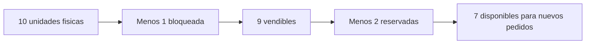
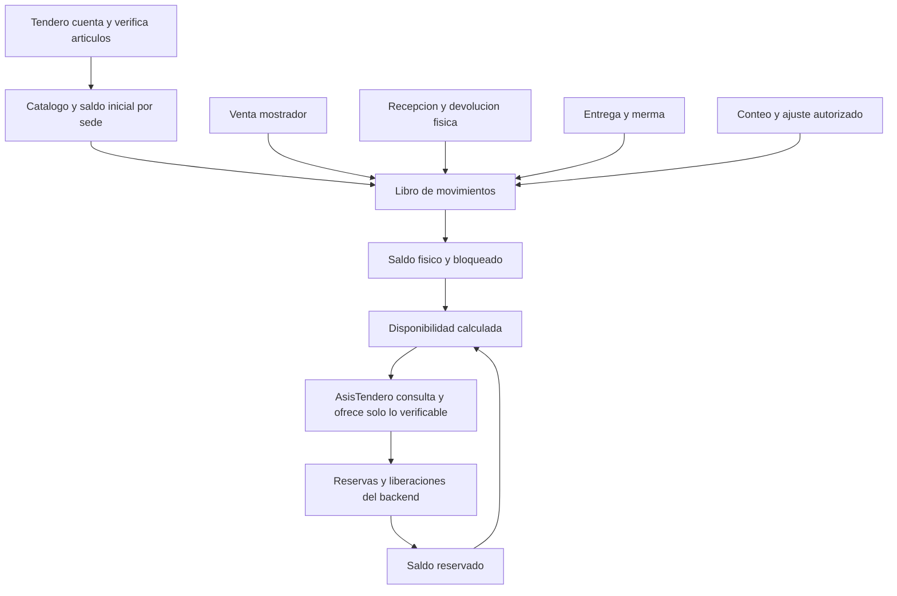

# PT-004 — Fuente de verdad del inventario y reglas de movimientos

**Estado:** propuesta para revisión conjunta; no implementada ni cerrada. **Versión:** 0.3, 13 de octubre de 2026 (America/Bogota). **Issue:** [PT-004](https://github.com/JulianCVM/AsisTendero/issues/4). **Dependencia:** PT-001, todavía en definición. **Criterio de aceptación de la issue:** política escrita para stock físico, reservado y disponible; ventas presenciales, entregas, recepciones y ajustes.

## 1. Decisión de principio

**[ACORDADO por los usuarios, 13-10-2026]** Los tenderos conocen y controlan físicamente lo que hay en el local. Con su ayuda se busca **censar y mantener todo el inventario vendible**, para que AsisTendero pueda ofrecer por chat todos los productos que el negocio realmente vende, no solo una selección arbitraria. El personal del local registra o confirma los hechos físicos: conteos, ventas de mostrador, recepción de mercancía, preparación, entregas, pérdidas y devoluciones.

**[ACORDADO por los usuarios, 13-10-2026]** En el piloto, **cada venta de mostrador se registra al cobrar mediante una venta rápida en PulsoTienda**. Ese registro actualiza inmediatamente el inventario que consulta AsisTendero. Un fiado presencial autorizado se registra como venta/entrega y cuenta por cobrar, sin marcarlo como pago recibido.

**[ACORDADO por los usuarios, 13-10-2026]** Distintas sedes de un negocio pueden ofrecer surtidos diferentes y trasladarse stock. Un SKU del catálogo del negocio no se ofrece automáticamente en todas las sedes; cada sede debe habilitarlo y contar con precio y disponibilidad aplicables.

**[PROPUESTO]** La fuente operativa para responder al cliente es el **registro de inventario de PulsoTienda por negocio y sede**, alimentado por esos hechos humanos y por las reservas que el backend crea de forma controlada. El tendero es la autoridad sobre la realidad física; el sistema conserva el saldo, procedencia, fecha y diferencias. AsisTendero consulta y propone mediante herramientas autorizadas; **no inventa existencias, no altera cantidades por conversación y no accede libremente a la base de datos**. Si una cifra digital no coincide con la estantería, se corrige con un movimiento auditable, sin sobrescribir silenciosamente el historial.

La aspiración de «conteo total» es un **objetivo de cobertura y disciplina operativa**, no un hecho demostrado hoy. Una tienda que no registre ventas presenciales a tiempo no puede prometer disponibilidad exacta por WhatsApp: el sistema debe mostrar ese límite y pedir comprobación al personal donde corresponda.

## 2. Qué se censa y cuándo un artículo es vendible por chat

La unidad de inventario es una **variante vendible concreta** en una sede: por ejemplo, «codo PVC 1/2 pulgada, marca X, unidad» y «codo PVC 3/4 pulgada» son registros distintos. Se guardan identificador/SKU interno, nombre y alias locales, categoría, marca y atributos necesarios, unidad de venta, precio vigente, estado, sede, ubicación y cantidad inicial verificada. Foto y código de barras son útiles cuando existan; **la foto no reemplaza al SKU ni al conteo**. Para tienda de barrio se podrán activar lote/vencimiento por producto; para ferretería, medida, presentación y unidad son esenciales. El precio es un dato comercial distinto del saldo.

| Estado de catálogo propuesto | Significado para AsisTendero |
|---|---|
| `pendiente_de_censo` | Producto mencionado o importado, pero sin cantidad/precio comprobados por el local. Puede registrar demanda; no prometer entrega. |
| `verificado` | El tendero confirmó identidad, unidad, precio y conteo inicial; el sistema puede calcular disponibilidad. |
| `pausado` | El comercio lo retiró temporalmente de la oferta o hay duda material. No se ofrece como disponible. |
| `descontinuado` | Se conserva historial, pero no se crean nuevas reservas. |

**[PROPUESTO] Censo inicial:** (1) reunir lo existente en cuaderno, caja, lista de proveedores o estantería; (2) normalizar nombres, variantes y unidades con el tendero; (3) contar físicamente por sede y, si aplica, lote/ubicación; (4) cargar precio y condiciones comerciales; (5) registrar quién verificó y cuándo; (6) revisar duplicados y diferencias; (7) activar `verificado` para venta por chat. La meta es cubrir **todos los artículos que el local pretende vender por WhatsApp**. Mientras falten productos por censar, AsisTendero lo reconoce y deriva la consulta al tendero o la registra como demanda; no responde «agotado» solo porque un artículo aún no exista en el catálogo.

Las presentaciones deben tener una regla explícita: vender por unidad, caja, metro, kilo o fracción no puede descontar cantidades ambiguas. Si una caja contiene 12 unidades, se fija una unidad base y conversión aprobada. Combos o kits requieren comprobar componentes o un SKU propio con su política, que se definirá en PT-005/PT-018.

## 3. Saldos y fórmulas

Todos los saldos pertenecen a una combinación de **negocio + sede + SKU/variante** y, cuando corresponda, lote. No se suman inventarios de sedes para prometer recogida en una sede específica.

| Término | Definición propuesta |
|---|---|
| `fisico_total` | Unidades que están materialmente bajo control del local, incluidas las temporalmente apartadas y las no aptas para vender. Proviene de conteo inicial más movimientos físicos confirmados. |
| `bloqueado` | Parte del físico no apta para vender: vencido, dañado, en cuarentena, pendiente de inspección o apartado por recuperación tras cancelación. Conserva motivo y ubicación. |
| `fisico_vendible` | `fisico_total - bloqueado`. Mercancía presente y apta antes de descontar compromisos. |
| `reservado` | Parte del físico vendible asignada a pedidos vigentes: reserva de cinco minutos, gracia/extension aún activa, pedido pagado o pedido en preparación/recogida. Una reserva vence solo cuando la política PT-003 la libera realmente. |
| `disponible_para_nuevas_ventas` | `fisico_vendible - reservado`. Esta es la cifra que usa el backend para decidir una nueva reserva o venta. |

Ejemplo: 10 unidades físicas, 1 dañada y 2 reservadas → **7 disponibles** para nuevos pedidos. La pantalla muestra las cuatro cifras y permite abrir el detalle de cada bloqueo y reserva. Si el cálculo llega a negativo por una discrepancia, **no se disimula con un cero interno**: se crea alerta, se frena la nueva promesa comercial de ese SKU y se pide conteo/corrección. El mensaje al cliente puede expresar «necesito confirmar disponibilidad» sin revelar el saldo interno.

**Reserva lógica frente a apartado físico.** El backend impide que dos pedidos reserven la misma última unidad digital. Para una promesa de recogida, el personal debe además seleccionar y apartar físicamente el artículo durante la preparación. Hasta entonces puede existir una discrepancia por una venta en estantería no registrada; por eso el aviso «listo» depende de la confirmación física de PT-003. Las reservas pagadas siguen ocupando `reservado` hasta entrega o resolución; el pago no descuenta `fisico_total`.

## 4. Libro de movimientos: qué cambia cada evento

Cada hecho se registra **una sola vez** con tipo, cantidad, negocio/sede, SKU, lote si aplica, causa, documento de origen, actor y hora. Las cantidades se agregan como movimientos; no se edita directamente un número suelto para «hacerlo cuadrar». Las implementaciones pertenecen a PT-019 y PT-020.

| Evento | `fisico_total` | `bloqueado` | `reservado` | Condición/autoridad |
|---|---:|---:|---:|---|
| Conteo inicial verificado | Establece línea base | Establece no vendible identificado | 0 inicialmente | Tendero/encargado autorizado verifica cantidades y unidad. |
| Reserva de pedido por chat | 0 | 0 | `+cantidad` | Backend, tras intención confirmada, stock suficiente y política PT-003; operación atómica. |
| Aviso de cinco minutos, extensión o pago | 0 | 0 | 0 | Cambia plazo/estado; durante gracia confirmada se conserva la reserva hasta liberación explícita. |
| Preparación y «pedido listo» | 0 | 0 | 0 | Personal aparta y confirma físicamente; la misma reserva continúa. Si faltan unidades, abre incidencia. |
| Reserva vencida/cancelada, mercancía aún en estante | 0 | 0 | `-cantidad` | Backend libera una sola vez tras regla PT-003. |
| Reserva cancelada, mercancía ya apartada en zona de retiro | 0 | `+cantidad` | `-cantidad` | Personal confirma ubicación; queda bloqueada hasta devolverla físicamente a estante. Evita ofrecer una unidad que nadie encuentra. |
| Devolución del apartado a estante vendible | 0 | `-cantidad` | 0 | Personal confirma inspección y ubicación. |
| Entrega de pedido reservado | `-cantidad` | 0 | `-cantidad` | Personal confirma código, contenido y pago o fiado autorizado; ambos cambios en una sola operación. |
| Venta de mostrador no reservada | `-cantidad` | 0 | 0 | Personal registra venta al cobrar/entregar; no permite vender digitalmente lo reservado. |
| Pedido al proveedor aprobado o enviado | 0 | 0 | 0 | La orden es expectativa, no mercancía recibida. |
| Recepción de proveedor aceptada | `+cantidad recibida` | 0 o `+cantidad en cuarentena` | 0 | Personal cuenta y acepta lo recibido; una entrega parcial solo añade lo efectivamente recibido. |
| Daño o vencimiento detectado en estante | 0 | `+cantidad` | 0 | Personal retira de oferta y documenta motivo; si afecta una reserva, se abre incidencia. |
| Descarte físico de mercancía bloqueada | `-cantidad` | `-cantidad` | 0 | Personal confirma descarte; conserva evidencia/motivo. |
| Devolución de cliente recibida | `+cantidad` | `+cantidad` inicialmente | 0 | Tendero inspecciona; solo vuelve a vendible cuando confirme su aptitud y quite el bloqueo. |
| Ajuste tras conteo | `+/- diferencia` | Según hallazgo | Puede exigir resolver reservas afectadas | Personal registra conteo y motivo; dueño aprueba diferencias relevantes según umbral pendiente. |

**No duplicar salidas:** un pedido pagado, preparado y entregado produce **una** salida física: al confirmar entrega. El paso de `reservado` a cero ocurre en esa misma operación. La venta de mostrador genera su propia salida en el momento real de venta; no vuelve a descontarse por cierre de caja. Una devolución de dinero no crea inventario: solo la devolución física inspeccionada puede hacerlo.

## 5. Venta presencial y conflictos con el chat

**[ACORDADO]** El tendero registra cada venta de mostrador mediante **venta rápida en PulsoTienda al cobrar**, con SKU, cantidad, unidad, sede y medio de pago; si es fiado, con autorización presencial y cuenta por cobrar. El saldo disminuye inmediatamente y una sola vez. **[PROPUESTO]** La pantalla debe permitir búsqueda rápida por nombre/código, cantidades, corrección antes de confirmar y comprobación del saldo; el diseño exacto corresponde a PT-007 y la implementación a PT-025. Si una venta física no se registra por una falla operativa, el inventario deja de ser fiable hasta regularizarla; el agente pide comprobación en lugar de prometer disponibilidad exacta.

Cuando un cliente presencial desea la última unidad y ya está reservada para otro pedido, el panel debe mostrar **disponible = 0** y avisar al tendero. El personal no la libera por conveniencia sin cancelar o resolver formalmente el pedido anterior. Si la unidad se vendió físicamente por error antes de registrar la operación, el sistema abre incidencia, informa al agente y evita prometerla de nuevo; se corrige la venta y la reserva con trazabilidad, junto con la solución al cliente afectado. No se permite stock vendible negativo para «continuar». Un pago tardío no restaura automáticamente unidades liberadas.

## 6. Recepción, ajustes, conteos y vencimientos

**Recepción:** la orden al proveedor no aumenta stock. El tendero cuenta lo recibido por SKU, unidad, sede y lote aplicable; registra faltantes, sobrantes, daño y fecha real. Solo la cantidad aceptada entra al físico vendible. Lo rechazado no se suma; lo pendiente de inspección entra a `fisico_total` y `bloqueado` si está bajo custodia del local. Esto alimenta el historial de cumplimiento del proveedor y las propuestas futuras, sin permitir que AsisTendero invente una recepción.

**Conteo cíclico:** el personal cuenta por producto/ubicación con una hora de corte. El sistema compara el conteo con el saldo calculado desde el libro de movimientos y muestra diferencia, operaciones ocurridas mientras se contaba y reservas vigentes. El ajuste guarda responsable, motivo y aprobación según política; nunca borra el conteo anterior. **[PROPUESTO]** Priorizar artículos de alta rotación, última unidad, alto valor, historial de diferencias y perecederos; los intervalos concretos se fijan con el local. Un conteo completo inicial y luego conteos parciales son compatibles con la meta de cobertura total.

**Vencimiento y merma:** el control de lote/fecha se activa por producto cuando aplica. Un lote vencido o dañado se bloquea para venta y para AsisTendero. La merma física se descuenta cuando realmente se descarta. El agente alerta y prepara medidas comerciales permitidas para productos próximos a vencer, pero no decide por sí mismo vender un producto vencido, alterar fechas o escribir un ajuste. Si una devolución no está apta para reventa, permanece bloqueada o se descarta tras registro.

**Traslados entre sedes [ACORDADO como capacidad]:** son movimientos ligados de salida de origen y entrada **al recibir físicamente** en destino; la mercancía en tránsito no se ofrece en ninguna sede. Solo puede salir stock disponible, no el reservado a clientes. No se crea disponibilidad en destino por solicitar, aprobar o despachar el traslado. Si esa sede todavía no ofrece el SKU, lo recibido queda bloqueado para nuevas ventas hasta que el tendero habilite el producto y confirme su precio. Cantidades despachadas, recibidas y faltantes quedan diferenciadas. Una sola sede puede ser el piloto sin perder esta regla del modelo multinegocio; quién aprueba el traslado sigue pendiente.

## 7. Responsabilidades del tendero, AsisTendero y backend

| Actor | Puede hacer | No debe hacer |
|---|---|---|
| Dueño | Definir política, validar censo, aprobar ajustes importantes y resolución de faltantes que afecten dinero. | Dar por buena una cifra sin registrar la corrección. |
| Encargado/empleado autorizado | Contar, registrar venta presencial, recibir proveedor, preparar y confirmar entrega, marcar daño, devolver apartado al estante. | Cambiar el historial sin motivo ni permisos; confirmar recepción no vista. |
| AsisTendero | Buscar productos, consultar disponibilidad vigente, cotizar, solicitar reserva por herramienta, informar caducidad, avisar diferencias, proponer conteos y reposición con evidencia. | Marcar conteo físico, venta presencial, recepción, merma o ajuste como hechos observados por él; prometer stock no verificado. |
| Backend | Mantener saldos, bloquear sobreventa, aplicar reservas/caducidad, impedir duplicados, registrar auditoría y avisar incidencias. | Inferir mercancía física a partir de pagos, órdenes de compra o fotos. |

El dueño puede delegar funciones operativas con alcance definido por negocio/sede conforme a PT-002. Las correcciones relevantes de stock exigen la aprobación humana fijada allí. La herramienta del agente solo recibe identificadores y operaciones de negocio, jamás SQL libre; el backend vuelve a comprobar saldo, permisos, versión y negocio antes de modificar.

## 8. Información mínima y controles de calidad

**Por producto:** `business_id`, `store_id`, SKU/variante, unidad base y conversión, nombre/alias, categoría, precio y vigencia, estado de catálogo, ubicación y atributos del segmento. **Por saldo:** físico, bloqueado, reservado, disponible calculado, versión/hora de la última operación y fecha del último conteo. **Por movimiento:** identificador único, tipo, cantidad, unidad, SKU, sede, lote cuando aplique, origen (pedido/venta/recepción/conteo/devolución), referencia, actor, hora y motivo. **Por reserva:** pedido, cantidad, vencimiento, extensión, estado y condición de apartado físico. **Por incidencia:** diferencia, producto afectado, pedido comprometido, responsable y resolución.

Los cambios deben ser **idempotentes**: repetir un webhook, un clic o una tarea de vencimiento no puede sumar/restar dos veces. Una reserva comprueba `disponible` y actualiza el saldo en una operación atómica para que dos clientes no obtengan la última unidad. Los ajustes no pueden consumir mercancía reservada sin abrir y resolver la incidencia correspondiente. Toda consulta del agente debe indicar de qué negocio/sede y momento proviene el dato. Ningún usuario de un negocio puede consultar o afectar saldos de otro.

## 9. Casos que fijan la política

1. Se carga un artículo desde un cuaderno, pero falta conteo: queda `pendiente_de_censo`; AsisTendero no lo ofrece como disponible y pide verificación al tendero.
2. Hay una sola unidad vendible y un pedido por chat la reserva: disponible pasa a cero sin reducir físico; otro pedido o venta de mostrador no puede tomarla.
3. A los cinco minutos se avisa al cliente: la reserva permanece durante la ventana de respuesta definida en PT-003; solo la liberación efectiva aumenta disponible.
4. El cliente paga por Wompi: cambia pago, no físico; el personal aparta, confirma pedido listo y después entrega; al entregar, físico y reservado bajan una vez.
5. Se vende por mostrador un producto no reservado: el empleado registra la salida en la misma fuente de verdad antes de que el agente vuelva a ofrecerlo.
6. Llega un proveedor con 8 de 10 unidades pedidas: solo 8 aceptadas aumentan físico; quedan 2 pendientes en orden de compra.
7. Hay 10 unidades según sistema y 9 al contar: se registra diferencia y motivo; el ajuste autorizado reduce físico en una unidad y mantiene el historial.
8. Una devolución vuelve dañada: el tendero recibe una unidad en `fisico_total` y la bloquea; no se vende por chat ni se asume reembolso automático.
9. Se cancela un pedido preparado: su apartado pasa temporalmente a bloqueado; solo vuelve a disponible cuando personal confirma que regresó a estante.
10. El tendero encuentra vencido un lote: lo bloquea y AsisTendero deja de ofrecer esas unidades; el descarte físico posterior queda como segundo hecho.

## 10. Pendientes para cerrar PT-004 con la pareja y el piloto

| Prioridad | Pregunta concreta | Propuesta de partida |
|---|---|---|
| Alta | ¿Quiénes usarán la venta rápida en cada turno y cómo se registrarán ventas si falla la conexión? | El dueño asigna empleados autorizados; definir procedimiento de contingencia y regularización antes de prometer stock por chat. |
| Alta | ¿Quién lidera el censo completo inicial, cuánto catálogo hay y qué datos están disponibles? | Dueño nombra responsable por sede y valida una carga inicial con conteo físico. |
| Alta | ¿Qué artículos requieren lote/vencimiento y cuáles usan medidas, fracciones o cajas? | Configuración por producto; no imponer lote a toda la ferretería. |
| Alta | ¿Qué ajuste puede registrar el encargado y cuál necesita aprobación del dueño? | Umbral por cantidad/valor y motivo, acordado en PT-002; el agente no ejecuta ajustes. |
| Alta | ¿Cuándo se aparta físicamente un pedido pagado o reservado y quién comprueba la última unidad? | La preparación PT-003 confirma apartado; si hay diferencia, incidencia antes del aviso de listo. |
| Media | ¿Cada cuánto se cuentan artículos de alta rotación, alto valor y baja confianza? | Conteo cíclico según riesgo y recursos del local; revisar métricas de diferencias. |
| Media | ¿Qué ocurre al operar sin red o cuando la caja no se puede sincronizar? | Marcar disponibilidad como no confiable y priorizar comprobación humana; definir procedimiento por piloto. |
| Media | ¿Quién autoriza traslados y qué política rige devoluciones, combos y artículos a granel? | Traslados entre sedes ya forman parte del modelo; definir permisos/umbrales y casos presentes en el primer comercio. |

**Revisión de aceptación:** la pareja valida la fórmula de saldos, cada fila de movimientos, la operación real del tendero y las respuestas pendientes del piloto. Esta propuesta no afirma que el inventario esté contado ni que el sistema ya lo controle. La implementación posterior se reparte entre PT-019, PT-020, PT-021, PT-022, PT-025 y PT-042.

