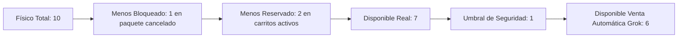
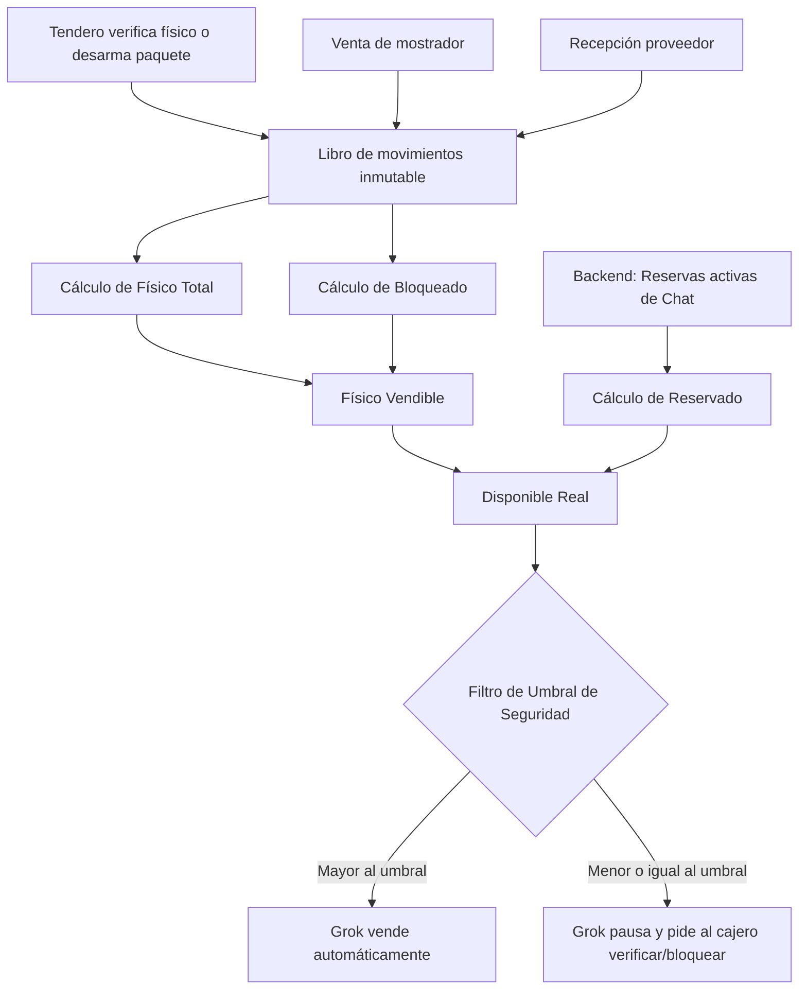

# PT-004 — Fuente de verdad del inventario y reglas de movimientos

**Estado:** Documento base acordado y alineado con arquitectura operativa.  
**Versión:** 0.5, 13 de octubre de 2026.  
**Dependencia:** Alineado con PT-001 (Alcance), PT-002 (Permisos) y PT-003 (Estados y Reservas).

## 1. Decisión de principio y fuente de verdad

**[ACORDADO]** Los tenderos conocen y controlan físicamente lo que hay en el local. El sistema busca censar y mantener el inventario vendible mediante el registro humano de los hechos físicos: ventas de mostrador, recepción, desarme de paquetes y mermas.

La fuente de verdad es el **registro de inventario de PulsoTienda por negocio y sede**. AsisTendero consulta y propone mediante herramientas (*Tools*); no inventa existencias y no altera cantidades por chat de forma arbitraria.

## 2. Fórmulas de saldo y umbral de seguridad

Todos los saldos pertenecen a la combinación `business_id` + `store_id` + `SKU`. Las unidades apartadas físicamente para entrega **NO** se suman al disponible.

| Variable de inventario | Fórmula y definición |
|---|---|
| `fisico_total` | Total de unidades bajo techo del local (vendibles, dañadas y empaquetadas). |
| `bloqueado` | Unidades **no aptas para venta nueva**: cuarentena, dañadas o empaquetadas en la zona de retiros esperando entrega o desarme tras un *No-Show*. |
| `reservado` | Unidades asignadas lógicamente a un pedido en curso (`reserva_digital_corta` o `reserva_en_tienda`). |
| `disponible_real` | `fisico_total - bloqueado - reservado`. Lo que matemáticamente queda libre. |
| `umbral_seguridad` | **[NUEVO]** Stock mínimo de protección configurable por SKU/negocio (MVP: defecto 1). |
| `disponible_venta_automatica` | `disponible_real - umbral_seguridad`. Unidades que Grok puede vender por chat sin preguntar. |

## 3. Venta presencial y fallo seguro por umbral (Race Condition Prevention)

Para evitar que una venta presencial no registrada a tiempo colisione con una venta por WhatsApp, AsisTendero utiliza el `umbral_seguridad`.

**Flujo de protección de última unidad:**

1. Si un cliente por chat pide 1 unidad y el `disponible_real` es 1 (llegando al umbral de seguridad), AsisTendero **no confirma** la orden automáticamente.
2. El agente responde: *"Me figura 1 unidad, pero para no fallarte, le pediré al personal del mostrador que verifique físicamente. Te confirmo en un momento."*
3. El panel del tendero lanza una alerta: *"Verificar y apartar 1 unidad de SKU X para chat"*.
4. **Bloqueo preventivo (prevención de colisión):** cuando el empleado encuentra la unidad y pulsa *"Confirmar existencia"*, el sistema **crea la reserva inmediatamente en ese milisegundo**, deduciendo el saldo *antes* de avisar al cliente.
5. AsisTendero recibe la señal y avisa al cliente: *"Confirmado, ya la apartamos para ti. ¿Pagas por Wompi o en tienda?"*

## 4. Libro de movimientos: qué cambia cada evento

El inventario es inmutable; se ajusta añadiendo registros de movimiento (tipo, cantidad, actor, origen, fecha), nunca sobrescribiendo la celda final.

| Evento | Efecto en `fisico` | Efecto en `bloqueado` | Efecto en `reservado` |
|---|---:|---:|---:|
| **Conteo inicial** | `+Cantidad` | `0` | `0` |
| **Reserva por chat (AsisTendero)** | `0` | `0` | `+Cantidad` |
| **Venta rápida en mostrador** | `-Cantidad` | `0` | `0` |
| **Entrega física de pedido reservado** | `-Cantidad` | `0` | `-Cantidad` |
| **Inasistencia (gatillo de `NO_SHOW`)** | `0` | `+Cantidad` | `-Cantidad` |

### 4.1. Desarme de paquetes tras inasistencia (Regla Anti-Phantom Stock)

Cuando el cronómetro de gracia vence y el sistema dispara el `NO_SHOW`, la reserva lógica se elimina (`reservado` disminuye), pero **la mercancía pasa automáticamente a `bloqueado`**, ya que físicamente sigue empaquetada en la estantería de retiros.

El botón **"Desarmar paquete cancelado"** no libera las unidades a ciegas. Abre un modal de comprobación línea por línea:

- El empleado lee: *"Paquete #123 debía tener 5 brocas"*.
- El empleado cuenta físicamente lo que hay en la bolsa y anota: *4 brocas*.
- **Ejecución del sistema:**
  - Saca 4 brocas de `bloqueado` (regresan a disponible).
  - Deja 1 broca en `bloqueado` y levanta una bandera de `incidencia_de_inventario` para que el dueño audite qué pasó con la unidad faltante. **No se inventa stock.**

## 5. Recepción, mermas y ajustes

- **Recepción de proveedor:** una orden de compra aprobada **NO** suma stock. Solo cuando el empleado cuenta las cajas que llegaron y registra la recepción, aumenta el `fisico_total`.
- **Merma / vencimiento:** el empleado detecta un producto dañado. Lo registra en el sistema. El `fisico_total` disminuye y se guarda el responsable y el motivo.
- **Ajuste cíclico (auditoría):** si el sistema dice 10 pero hay 9, el dueño o encargado autorizado registra un *"Ajuste negativo por descuadre"*. No borra el conteo anterior; añade un movimiento de `-1` con trazabilidad.

## 6. Escenarios que fijan la política

1. **Venta presencial cruzada:** hay 2 martillos (umbral: 1). Un cliente en mostrador toma uno, pero el cajero tarda 5 minutos en cobrarlo. Un cliente en WhatsApp pide 1 martillo. Grok ve 2 unidades en total y, como 2 - 1 = 1, aprueba la venta y reserva 1 para WhatsApp. El cajero luego cobra el del mostrador, dejando el sistema cuadrado (0 disponibles).

2. **Choque en el umbral:** queda 1 martillo (umbral: 1). Un cliente de WhatsApp lo pide. Grok ve disponible = 0 para venta automática. Pide confirmación. El empleado va al estante, ve que el martillo ya lo tiene un cliente en la fila física y rechaza la solicitud de Grok. Grok le dice al cliente del chat que se agotó.

3. **El paquete incompleto:** un cliente no fue por su pedido de "10 codos de PVC" (`NO_SHOW`). Los 10 codos pasan a `bloqueado`. El empleado va a desarmar la bolsa y solo encuentra 8 codos. Ingresa "8 verificados". El sistema devuelve 8 a venta y deja 2 bloqueados como "Faltantes por auditar". AsisTendero nunca ofrecerá esos 2 codos.

## 7. Arquitectura de estado y herramientas (Tools)

## 8. Verificaciones cerradas de esta especificación

- [x] **Separación inamovible:** `bloqueado` no suma a `disponible` bajo ninguna circunstancia.
- [x] **Race condition mitigado:** bloqueo intermedio mediante alerta al mostrador si se perfora el umbral de seguridad configurable.
- [x] **Anti-phantom stock:** desarme de `NO_SHOW` línea por línea, capturando mermas internas de empaquetado antes de devolver al estante.
- [x] **Prioridad de la caja física:** las ventas rápidas en mostrador descuentan inmediatamente el stock y tienen precedencia si no se había reservado la unidad digitalmente.

---